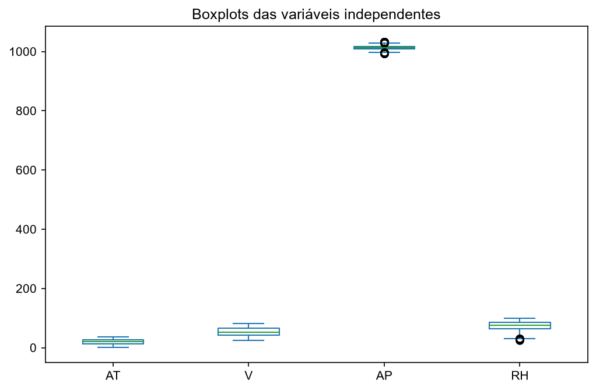
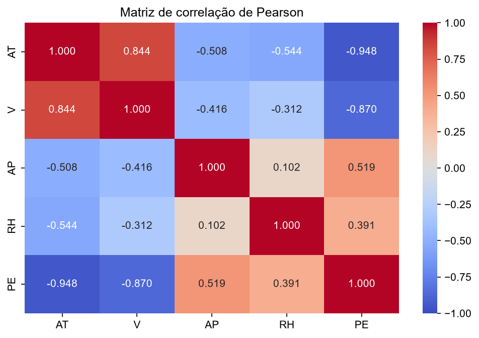
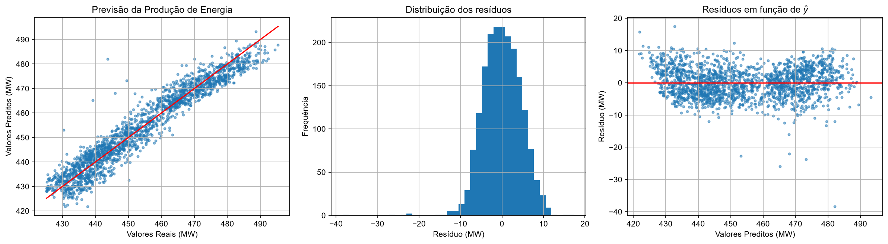

# Problema 1: Regressão Linear para Previsão de Produção de Energia em uma Usina de Ciclo Combinado

**Disciplina:** PAM0466 Sistemas Inteligentes | UFERSA, Centro Multidisciplinar Pau dos Ferros | 2026.2
**Aluno:** João Lucas Oliveira de Andrade
**Código:** [notebook.ipynb](notebook.ipynb)

---

## 1. Introdução

Uma usina termoelétrica de ciclo combinado (UTCC) combina uma turbina a gás (ciclo Brayton) e uma turbina a vapor (ciclo Rankine): o calor dos gases de exaustão da primeira produz o vapor que aciona a segunda, e o rendimento pode chegar a cerca de 60%. Como os dois ciclos precisam operar em conjunto, a potência elétrica de saída (PE) é muito sensível às condições ambientais.

Neste trabalho foi construído um modelo de **regressão linear múltipla** para prever PE a partir de quatro variáveis medidas por sensores ambientais:

$$PE = \theta_0 + \theta_1\,AT + \theta_2\,V + \theta_3\,AP + \theta_4\,RH$$

O código segue o notebook de regressão linear da disciplina (`05_Regressao_Linear.ipynb`): divisão com `train_test_split`, escalonamento ajustado só no treino, `LinearRegression` e avaliação com `mean_squared_error` e `r2_score`.

### Dataset

**UCI Combined Cycle Power Plant (CCPP)**, com 9.568 amostras coletadas ao longo de 6 anos, carregado pelo pacote `ucimlrepo` (id 294).

| Variável | Descrição | Unidade | Papel |
|---|---|---|---|
| AT | Temperatura ambiente | °C | Entrada |
| V | Vácuo de exaustão | cm Hg | Entrada |
| AP | Pressão atmosférica | mbar | Entrada |
| RH | Umidade relativa | % | Entrada |
| PE | Energia elétrica líquida horária de saída | MW | **Alvo** |

---

## 2. Pré-processamento

O pré-processamento segue as etapas de limpeza vistas na aula de pré-processamento (`04_Preprocessamento.ipynb`).

- **Dados incompletos:** `df.isna().sum()` mostrou **zero valores faltantes** em todas as colunas, portanto não foi preciso remover linhas nem imputar valores.
- **Dados redundantes:** foram encontradas **41 linhas duplicadas**, que foram removidas com `drop_duplicates()`. O conjunto final tem **9.527 amostras**.
- **Escala das variáveis:** as variáveis têm ordens de grandeza muito diferentes (AP em torno de 1.013 mbar, com desvio de 5,9; AT entre 1,8 e 37,1 °C; RH entre 25,6% e 100,2%).

| Variável | Média | Desvio padrão | Mínimo | Máximo |
|---|---|---|---|---|
| AT (°C) | 19,66 | 7,44 | 1,81 | 37,11 |
| V (cm Hg) | 54,29 | 12,69 | 25,36 | 81,56 |
| AP (mbar) | 1013,24 | 5,94 | 992,89 | 1033,30 |
| RH (%) | 73,33 | 14,61 | 25,56 | 100,16 |
| PE (MW) | 454,34 | 17,04 | 420,26 | 495,76 |

- **Divisão treino/teste:** 80% para treino (**7.621 amostras**) e 20% para teste (**1.906 amostras**), com `random_state=42`.
- **Padronização:** as variáveis independentes foram padronizadas por *z-score*, $z = (x-\mu)/\sigma$, com `StandardScaler` ajustado **apenas no treino** (`fit_transform`) e depois aplicado ao teste (`transform`), o que evita *data leakage*. A padronização também deixa os coeficientes do modelo comparáveis entre si.

---

## 3. Tarefa 1: Correlação entre as variáveis independentes e PE

| Variável | Correlação de Pearson com PE |
|---|---|
| AT | **−0,948** |
| V | **−0,870** |
| AP | +0,519 |
| RH | +0,391 |

**Resposta:** as variáveis com maior influência sobre a produção de energia são **AT** (r = −0,948) e **V** (r = −0,870), ambas com correlação forte e **negativa**: quanto maiores a temperatura ambiente e o vácuo de exaustão, menor a potência gerada. AT é a mais influente. AP (+0,519) tem correlação moderada e positiva, e RH (+0,391), correlação mais fraca, também positiva.

O sentido físico é coerente: ar mais quente é menos denso, o que reduz a massa de ar admitida pela turbina a gás e a potência; o vácuo de exaustão está ligado à pressão na turbina a vapor, e valores maiores indicam pior desempenho do ciclo Rankine. A correlação mede apenas relação **linear** e não implica causalidade.

---

## 4. Tarefa 2: Correlação entre as variáveis independentes (multicolinearidade)

| | AT | V | AP | RH |
|---|---|---|---|---|
| **AT** | 1,000 | **0,844** | −0,508 | −0,544 |
| **V** | **0,844** | 1,000 | −0,416 | −0,312 |
| **AP** | −0,508 | −0,416 | 1,000 | 0,102 |
| **RH** | −0,544 | −0,312 | 0,102 | 1,000 |

**Resposta:** sim. O par **AT–V** tem correlação de **+0,844**, o único acima de 0,7 em módulo, o que indica **multicolinearidade** entre essas duas variáveis: elas carregam boa parte da mesma informação. AT também tem correlação moderada com AP (−0,508) e RH (−0,544). Já AP e RH são quase independentes (0,102).

Como visto na aula de regressão linear, na presença de multicolinearidade a atribuição do efeito de cada variável sobre PE fica ambígua e os **coeficientes ficam instáveis**. Isso afeta a **interpretação** dos coeficientes individuais mais do que a capacidade de previsão do modelo, e aparece de forma concreta na Tarefa 3. É fisicamente plausível que AT e V estejam acopladas, já que a temperatura do ar influencia as condições de condensação do vapor.

---

## 5. Tarefa 3: Modelo de regressão linear múltipla

O modelo foi treinado com `LinearRegression()` (mínimos quadrados ordinários) sobre os dados de treino padronizados.

**Coeficientes (variáveis padronizadas):**

| Variável | Coeficiente $\theta_j$ |
|---|---|
| AT | **−14,6695** |
| V | −2,9798 |
| AP | +0,3737 |
| RH | −2,2977 |

Intercepto: $\theta_0$ = **454,3376**, que é a média de PE no treino, como esperado quando as entradas estão padronizadas (com todas as variáveis na média, $z = 0$).

**Equação na escala original** (desfazendo a padronização, $\theta_j^{orig} = \theta_j/\sigma_j$):

$$PE = 453{,}5863 - 1{,}9767\,AT - 0{,}2349\,V + 0{,}0630\,AP - 0{,}1570\,RH$$

Mantidas as demais variáveis constantes, cada aumento de 1 °C na temperatura ambiente reduz a potência prevista em cerca de 1,98 MW; cada 1 cm Hg a mais de vácuo reduz cerca de 0,23 MW; cada 1 mbar a mais de pressão aumenta cerca de 0,06 MW; e cada ponto percentual a mais de umidade reduz cerca de 0,16 MW. Esses coeficientes estão em unidades diferentes e **não são comparáveis entre si**; para comparar a importância das variáveis usam-se os coeficientes padronizados, nos quais **AT tem de longe o maior peso** (|θ| = 14,67).

**Efeito da multicolinearidade.** A correlação simples de RH com PE é **positiva** (+0,391), mas o seu coeficiente no modelo é **negativo** (−2,30). Isso ocorre porque RH é correlacionada com AT (−0,544): no modelo, o coeficiente de RH mede o efeito que sobra **depois de descontar AT e V**, enquanto a correlação simples mistura o efeito de RH com o de AT. Algo parecido acontece com AP (correlação de +0,519 com PE, mas coeficiente pequeno). Isso mostra que, havendo variáveis correlacionadas, os coeficientes individuais devem ser interpretados com cautela.

---

## 6. Tarefa 4: Avaliação do desempenho

Métricas no **conjunto de teste** (dados não vistos no treinamento):

| Métrica | Valor |
|---|---|
| R² | **0,9284** |
| RMSE | **4,5875 MW** |
| MAE | **3,6215 MW** |

| Referência | Valor | RMSE relativo |
|---|---|---|
| Média de PE | 454,34 MW | 1,01% |
| Faixa de PE (420,26 a 495,76 MW) | 75,50 MW | 6,08% |

**Treino × teste:** R² de 0,9284 no treino e 0,9284 no teste; RMSE de 4,55 MW no treino e 4,59 MW no teste. Os erros são praticamente iguais, o que indica que **não há sobreajuste**: o modelo generaliza tão bem quanto se ajusta ao treino.

### Verificação dos pressupostos nos resíduos

- **Previsto × real:** os pontos se concentram em torno da reta ideal, com um leve achatamento nas pontas (tendência a subestimar os maiores valores de PE e a superestimar os menores).
- **Normalidade dos erros:** o histograma dos resíduos é aproximadamente simétrico, em forma de sino e centrado em zero (média dos resíduos de 0,01 MW), com alguns poucos erros grandes na cauda esquerda (o resíduo vai de −38,4 MW a +17,5 MW).
- **Homocedasticidade:** no gráfico de resíduos em função de $\hat{y}$ não há formato de "funil", ou seja, a variância dos erros é aproximadamente constante. Há, porém, uma **leve curvatura**: resíduos mais positivos nas extremidades e mais negativos na região central.

**Resposta:** **sim, o modelo é adequado** para prever a produção de energia. Ele explica cerca de **93% da variância** de PE e erra, em média, cerca de 3,6 MW (MAE), o que corresponde a cerca de **1% da produção média**. O RMSE é pouco maior que o MAE, indicando poucos erros grandes. Os resíduos centrados em zero, simétricos e sem sinal de heterocedasticidade são compatíveis com os pressupostos da regressão linear, e as métricas de treino e teste iguais mostram boa generalização.

**Limitações:** a leve curvatura nos resíduos sugere uma pequena relação não linear que o modelo linear não captura, e a multicolinearidade entre AT e V prejudica a interpretação individual dos coeficientes (como mostrou a inversão de sinal de RH), embora afete pouco a previsão. A regularização (Ridge/Lasso), vista na aula, seria uma forma de estabilizar os coeficientes; não foi testada neste trabalho.

---

## 7. Conclusão

1. **Correlação com PE:** AT (−0,948) e V (−0,870) são as variáveis mais associadas à produção de energia, ambas de forma negativa; AP (+0,519) e RH (+0,391) têm associação menor.
2. **Multicolinearidade:** AT e V são fortemente correlacionadas (0,844).
3. **Modelo:** AT é a variável de maior peso (coeficiente padronizado −14,67); a inversão de sinal de RH ilustra o efeito da multicolinearidade sobre a interpretação dos coeficientes.
4. **Desempenho:** R² = 0,9284, RMSE = 4,59 MW e MAE = 3,62 MW no teste, sem sobreajuste; o modelo é adequado, com as ressalvas de uma leve não linearidade e da multicolinearidade entre AT e V.

---

## 8. Reprodutibilidade

- Código: [notebook.ipynb](notebook.ipynb), executável no Google Colab ou localmente (`pip install -r requirements.txt` na raiz do repositório).
- Dataset: UCI Machine Learning Repository, *Combined Cycle Power Plant* (id 294), obtido via `ucimlrepo`.
- Semente aleatória da divisão treino/teste: `random_state=42`.

---

## 9. Referências

1. SOUZA, P. T. V. *Sistemas Inteligentes*: slides 04 (Pré-processamento), 05 (Métricas de Performance) e 06 (Regressão Linear) e notebooks `04_Preprocessamento.ipynb` e `05_Regressao_Linear.ipynb`. UFERSA, 2026. Disponível em: https://github.com/pedrothiag/intelligent-systems.
2. TÜFEKCI, P.; KAYA, H. *Combined Cycle Power Plant*. UCI Machine Learning Repository, 2014.
