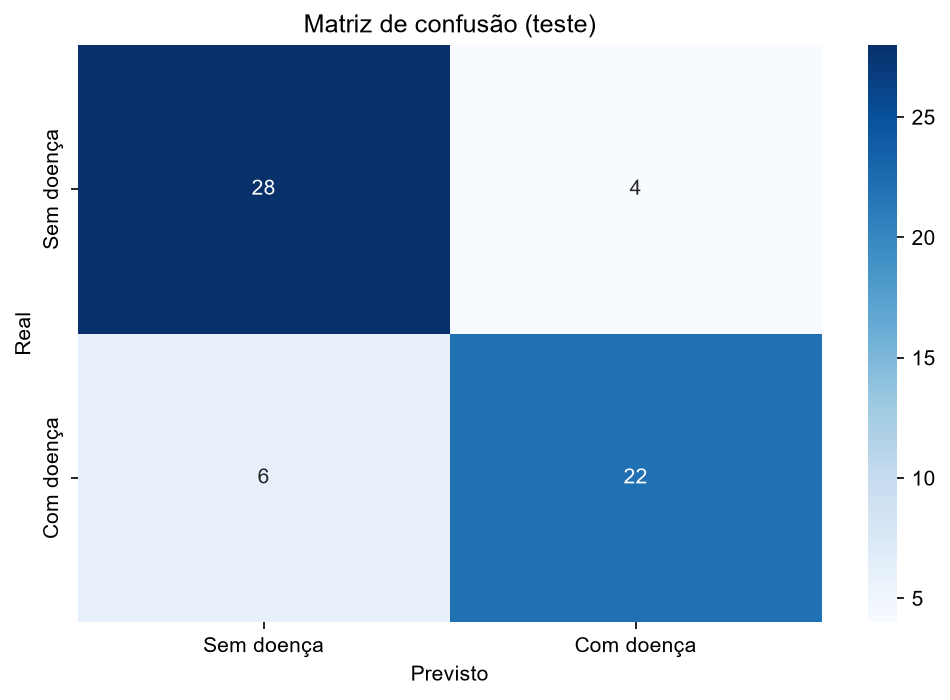
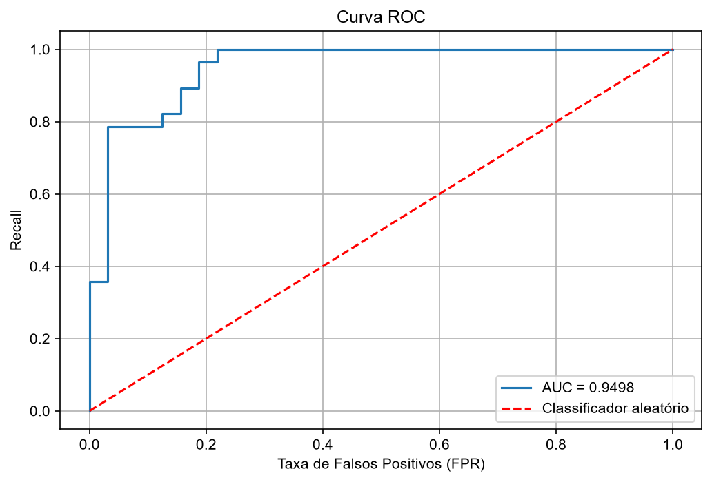

# Problema 2: Regressão Logística para Previsão de Doenças Cardíacas

**Disciplina:** PAM0466 Sistemas Inteligentes | UFERSA, Centro Multidisciplinar Pau dos Ferros | 2026.2
**Aluno:** João Lucas Oliveira de Andrade
**Código:** [notebook.ipynb](notebook.ipynb)

---

## 1. Introdução

As doenças cardiovasculares são a principal causa de morte no mundo, e o diagnóstico precoce é determinante para o sucesso do tratamento. Neste trabalho foi construído um modelo de **regressão logística** para estimar a presença de doença cardíaca a partir de dados clínicos coletados em consulta de rotina.

O código segue o notebook de regressão logística da disciplina (`06_Regressao_Logistica.ipynb`): `train_test_split`, `StandardScaler` ajustado no treino, `LogisticRegression`, leitura dos parâmetros por `intercept_` e `coef_`, cálculo manual da probabilidade pela sigmoide, matriz de confusão, métricas e curva ROC.

### Dataset

**Heart Disease (Cleveland)**, do repositório UCI, com 303 pacientes e 13 variáveis clínicas, carregado pelo pacote `ucimlrepo` (id 45). Os diagnósticos foram confirmados por cateterismo cardíaco.

| Variável | Descrição | Tipo |
|---|---|---|
| age | Idade (anos) | numérica |
| sex | Sexo biológico (1 = masculino, 0 = feminino) | binária |
| cp | Tipo de dor no peito (1 típica, 2 atípica, 3 não anginosa, 4 assintomática) | categórica codificada |
| trestbps | Pressão arterial em repouso (mmHg) | numérica |
| chol | Colesterol sérico total (mg/dl) | numérica |
| fbs | Glicemia em jejum > 120 mg/dl (1 = sim, 0 = não) | binária |
| restecg | ECG em repouso (0 normal, 1 alteração ST-T, 2 hipertrofia ventricular) | categórica codificada |
| thalach | Frequência cardíaca máxima no teste de esforço | numérica |
| exang | Angina induzida por exercício (1 = sim, 0 = não) | binária |
| oldpeak | Depressão do segmento ST durante o esforço | numérica |
| slope | Inclinação do segmento ST (1 ascendente, 2 plano, 3 descendente) | categórica codificada |
| ca | Nº de artérias coronárias com obstrução visível (0 a 3) | numérica discreta |
| thal | Cintilografia de tálio (3 normal, 6 defeito fixo, 7 defeito reversível) | categórica codificada |
| target | Diagnóstico original (0 a 4), binarizado | **alvo** |

---

## 2. Pré-processamento

### 2.1 Dados incompletos e redundantes

Foram encontrados valores ausentes em apenas duas colunas: **`ca` (4 valores)** e **`thal` (2 valores)**, em 6 linhas no total. Como a perda é de apenas cerca de 2% dos dados, o tratamento escolhido foi **remover as linhas incompletas** (`dropna`), restando **297 pacientes**. A alternativa vista em aula seria imputar a **moda** (adequada porque `ca` e `thal` são discretas). Não há linhas duplicadas.

As variáveis têm **escalas muito diferentes**, o que motiva a padronização:

| Variável | Média | Desvio padrão | Mínimo | Máximo |
|---|---|---|---|---|
| age | 54,44 | 9,04 | 29 | 77 |
| trestbps | 131,69 | 17,60 | 94 | 200 |
| chol | 246,69 | 51,78 | 126 | 564 |
| thalach | 149,61 | 22,88 | 71 | 202 |
| oldpeak | 1,04 | 1,16 | 0 | 6,2 |

### 2.2 Binarização do alvo

O diagnóstico original vai de 0 a 4 (0 = ausência de doença; 1 a 4 = graus crescentes de doença). Como o problema pede para prever **presença ou ausência** de doença, o alvo foi binarizado: **0 = sem doença** e **1 = com doença** (qualquer valor maior que 0). Essa transformação perde a informação de severidade.

| Classe | Pacientes | Proporção |
|---|---|---|
| 0 (sem doença) | 160 | 53,9% |
| 1 (com doença) | 137 | 46,1% |

As classes estão **razoavelmente equilibradas**, então a acurácia não é enganosa como seria em um conjunto muito desbalanceado.

### 2.3 Divisão treino/teste e padronização

- **Divisão:** 80% para treino (**237 pacientes**) e 20% para teste (**60 pacientes**), com `random_state=42` e divisão **estratificada** (`stratify=y`), que mantém a proporção de doentes nos dois conjuntos (46,0% no treino e 46,7% no teste).
- **Padronização:** *z-score*, $z = (x-\mu)/\sigma$, com `StandardScaler` ajustado **apenas no treino** e aplicado ao teste, evitando *data leakage*. Todas as variáveis foram padronizadas, o que também deixa os coeficientes comparáveis entre si.

---

## 3. Tarefa 1: Treinamento e convergência

A regressão logística estima a **probabilidade** de doença aplicando a função sigmoide a uma combinação linear das variáveis:

$$\hat{p} = \frac{1}{1 + e^{-\mathbf{x}^T\Phi}}$$

O paciente é classificado como "com doença" quando $\hat{p} \geq 0{,}5$. Os parâmetros são ajustados minimizando a entropia cruzada binária:

$$J(\theta) = -\frac{1}{N}\sum_{i=1}^{N}\left[y^{(i)} \log \hat{p}^{(i)} + (1-y^{(i)})\log(1-\hat{p}^{(i)})\right]$$

O modelo foi treinado com `LogisticRegression(solver='liblinear', random_state=42, max_iter=1000)`, conforme o enunciado.

**Resposta: número de iterações até a convergência.** O atributo `n_iter_` indica que o modelo convergiu em **5 iterações**, muito abaixo do limite de `max_iter = 1000`. Não houve problema de convergência.

**Parâmetros estimados.** Intercepto $\theta_0$ = **−0,0861**. Com todas as variáveis na média ($z = 0$), a probabilidade prevista é de cerca de 48%, coerente com as classes quase equilibradas. Coeficientes (variáveis padronizadas), ordenados por módulo:

| Variável | Coeficiente |
|---|---|
| ca | **+0,9589** |
| thal | **+0,7387** |
| cp | **+0,5083** |
| sex | +0,4840 |
| oldpeak | +0,4451 |
| trestbps | +0,4202 |
| exang | +0,3727 |
| slope | +0,3527 |
| fbs | −0,3312 |
| restecg | +0,3040 |
| chol | +0,2223 |
| thalach | −0,2071 |
| age | −0,0371 |

As variáveis de maior peso são **`ca`, `thal` e `cp`**; coeficiente positivo aumenta a probabilidade de doença e negativo a diminui. Cada coeficiente é a variação do logaritmo da razão de chances por aumento de 1 desvio padrão da variável; por exemplo, $e^{0{,}9589} \approx 2{,}6$: um desvio padrão a mais em `ca` multiplica as chances de doença por cerca de 2,6. Algumas leituras, **como hipóteses e não resultados comprovados**:

- `ca` (mais vasos obstruídos) e `oldpeak` (maior depressão do segmento ST) com sinal positivo são coerentes com maior carga de doença coronariana; `thalach` negativo indica que uma frequência cardíaca máxima mais baixa no esforço se associa a mais doença.
- `fbs` tem sinal negativo (−0,33), o que é **contraintuitivo**; com 237 pacientes no treino, não deve ser superinterpretado.
- O coeficiente quase nulo de `age` não significa que a idade seja irrelevante: sua informação pode já estar capturada por outras variáveis correlacionadas.
- `cp`, `restecg`, `slope` e `thal` são **categorias codificadas como números**, então o coeficiente supõe uma relação linear com a ordem dos códigos.

**Verificação manual.** Como no notebook da disciplina, montou-se o vetor $\Phi = [\theta_0, \theta_1, \dots, \theta_{13}]$ e calculou-se $\hat{p}$ pela sigmoide para o primeiro paciente do teste: **2,07%** de probabilidade de doença (previsão "sem doença", e o paciente de fato não tinha doença), o mesmo valor retornado por `predict_proba`.

---

## 4. Tarefa 2: Avaliação no conjunto de teste

### 4.1 Matriz de confusão

| | Previsto: sem doença | Previsto: com doença |
|---|---|---|
| **Real: sem doença** | 28 (VN) | 4 (FP) |
| **Real: com doença** | 6 (FN) | 22 (VP) |

O modelo acertou **50 dos 60 pacientes** do teste: identificou corretamente 28 pacientes sem doença e 22 com doença; classificou 4 saudáveis como doentes (falsos positivos) e 6 doentes como saudáveis (falsos negativos).

### 4.2 Métricas

Tomando "com doença" como classe positiva:

$$\text{Acurácia}=\frac{VP+VN}{VP+VN+FP+FN},\quad \text{Precisão}=\frac{VP}{VP+FP},\quad \text{Recall}=\frac{VP}{VP+FN},\quad F1=2\cdot\frac{\text{Precisão}\cdot\text{Recall}}{\text{Precisão}+\text{Recall}}$$

| Métrica | Valor |
|---|---|
| Acurácia | **0,8333** |
| Precisão | **0,8462** |
| Recall | **0,7857** |
| F1-score | **0,8148** |
| AUC (curva ROC) | **0,9498** |

| Classe | Precisão | Recall | F1 | Suporte |
|---|---|---|---|---|
| Sem doença | 0,82 | 0,88 | 0,85 | 32 |
| Com doença | 0,85 | 0,79 | 0,81 | 28 |

Quando aponta doença, o modelo acerta cerca de 85% das vezes (22 de 26); ele detecta cerca de 79% dos doentes reais (22 de 28).

### 4.3 Curva ROC e AUC

A curva ROC mostra, para cada limiar de decisão, o recall (taxa de verdadeiros positivos) contra a taxa de falsos positivos. A diagonal tracejada é um classificador aleatório (AUC = 0,5). A **AUC** pode ser lida como a probabilidade de o modelo atribuir uma probabilidade maior a um paciente doente sorteado do que a um saudável sorteado.

Obteve-se **AUC = 0,9498**: alta capacidade de **separar** doentes de saudáveis. A AUC é maior que a acurácia (0,83) porque avalia o ordenamento das probabilidades em **todos** os limiares, enquanto a acurácia usa apenas o limiar 0,5. A curva tem formato "em degraus" porque o teste tem apenas 60 pacientes.

### 4.4 Discussão

- **Desempenho geral:** bom para um classificador linear simples (acurácia de 0,83, F1 de 0,81 e AUC de 0,95), com equilíbrio razoável entre as classes.
- **Erro mais grave:** em diagnóstico, o **falso negativo** (doente classificado como saudável) é o pior erro, pois pode adiar uma intervenção necessária. O modelo cometeu **6 falsos negativos** (cerca de 21% dos 28 doentes) e **4 falsos positivos** (12,5% dos 32 saudáveis). O recall (0,79) ficou abaixo da precisão (0,85), ou seja, o modelo é um pouco mais conservador do que o desejável para uma triagem.
- **Limiar de decisão:** na própria curva ROC, o primeiro ponto com **recall = 1** (nenhum falso negativo) corresponde ao limiar de **0,187**, com taxa de falsos positivos de **0,219** (cerca de 7 dos 32 saudáveis). Reduzir o limiar de 0,5 para um valor dessa ordem eliminaria os falsos negativos neste teste, à custa de mais falsos positivos. Esse limiar foi **lido no conjunto de teste**, então é apenas uma ilustração do compromisso entre os dois erros; para adotá-lo de fato, ele precisaria ser escolhido sem usar o teste (por exemplo, por validação cruzada no treino).

---

## 5. Limitações

- **Conjunto de teste pequeno (60 pacientes):** cada erro altera a acurácia em cerca de 1,7 ponto percentual, e apenas uma divisão treino/teste foi avaliada.
- **Variáveis categóricas como números:** `cp`, `restecg`, `slope` e `thal` foram tratadas como numéricas; o *one-hot encoding*, visto na aula de pré-processamento, seria uma alternativa, não testada aqui.
- **Dataset pequeno e de origem única** (Cleveland): os resultados podem não se generalizar para outras populações.
- **Uso clínico:** o modelo é um trabalho acadêmico e não substitui a avaliação médica.

---

## 6. Conclusão

1. **Pré-processamento:** dos 303 pacientes, 6 foram removidos por valores ausentes (`ca` e `thal`), restando 297. O alvo foi binarizado em 160 sem doença e 137 com doença, e os dados foram divididos de forma estratificada em 237 para treino e 60 para teste, com padronização ajustada apenas no treino.
2. **Tarefa 1:** o modelo (`liblinear`, `random_state=42`, `max_iter=1000`) **convergiu em 5 iterações**. As variáveis de maior peso foram `ca`, `thal` e `cp`.
3. **Tarefa 2:** no teste, acurácia de **0,8333**, precisão de **0,8462**, recall de **0,7857**, F1 de **0,8148** e **AUC de 0,9498**. O modelo tem bom desempenho, com a ressalva de que os **6 falsos negativos** merecem atenção em contexto médico.

---

## 7. Reprodutibilidade

- Código: [notebook.ipynb](notebook.ipynb), executável no Google Colab ou localmente (`pip install -r requirements.txt` na raiz do repositório).
- Dataset: UCI Machine Learning Repository, *Heart Disease* (id 45), obtido via `ucimlrepo`.
- Semente aleatória: `random_state=42` (divisão treino/teste e modelo).

---

## 8. Referências

1. SOUZA, P. T. V. *Sistemas Inteligentes*: slides 04 (Pré-processamento), 05 (Métricas de Performance) e 07 (Regressão Logística) e notebooks `04_Preprocessamento.ipynb` e `06_Regressao_Logistica.ipynb`. UFERSA, 2026. Disponível em: https://github.com/pedrothiag/intelligent-systems.
2. JANOSI, A.; STEINBRUNN, W.; PFISTERER, M.; DETRANO, R. *Heart Disease*. UCI Machine Learning Repository, 1988.
