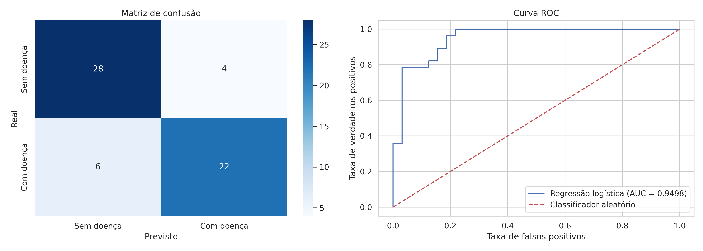

# Problema 2: Regressão Logística para Previsão de Doenças Cardíacas

**Disciplina:** PAM0466 Sistemas Inteligentes | UFERSA, Centro Multidisciplinar Pau dos Ferros | 2026.2
**Aluno:** João Lucas Oliveira de Andrade
**Código:** [notebook.ipynb](notebook.ipynb)

---

## 1. Introdução

As doenças cardiovasculares são a principal causa de morte no mundo, e o diagnóstico precoce é determinante para o sucesso do tratamento. Neste trabalho, construiu-se um modelo de **regressão logística** para estimar a presença de doença cardíaca a partir de dados clínicos simples, coletados em consulta de rotina.

### Dataset

**Heart Disease (Cleveland)**, do repositório UCI, com 303 pacientes e 13 variáveis clínicas, carregado pelo pacote `ucimlrepo` (id 45). Os diagnósticos foram confirmados por cateterismo cardíaco.

| Variável | Descrição | Tipo |
|---|---|---|
| age | Idade (anos) | numérica |
| sex | Sexo biológico (1 = masculino, 0 = feminino) | binária |
| cp | Tipo de dor no peito (1 típica, 2 atípica, 3 não anginosa, 4 assintomática) | categórica codificada |
| trestbps | Pressão arterial em repouso (mmHg) | numérica |
| chol | Colesterol sérico total (mg/dl) | numérica |
| fbs | Glicemia em jejum > 120 mg/dl (1 = sim, 0 = não) | binária |
| restecg | ECG em repouso (0 normal, 1 alteração ST-T, 2 hipertrofia ventricular) | categórica codificada |
| thalach | Frequência cardíaca máxima no teste de esforço | numérica |
| exang | Angina induzida por exercício (1 = sim, 0 = não) | binária |
| oldpeak | Depressão do segmento ST durante o esforço | numérica |
| slope | Inclinação do segmento ST (1 ascendente, 2 plano, 3 descendente) | categórica codificada |
| ca | Nº de artérias coronárias com obstrução visível (0 a 3) | numérica discreta |
| thal | Cintilografia de tálio (3 normal, 6 defeito fixo, 7 defeito reversível) | categórica codificada |
| target | Diagnóstico original (0 a 4), binarizado | **alvo** |

---

## 2. Pré-processamento

### 2.1 Inspeção e valores ausentes

O dataset tem dimensão **(303, 14)**: 303 pacientes, 13 variáveis e o alvo. As faixas das variáveis são plausíveis (idade de 29 a 77 anos), com valores máximos altos em `chol` (564 mg/dl) e `trestbps` (200 mmHg) que merecem atenção, mas podem ser clinicamente reais. As variáveis têm **escalas muito diferentes** (por exemplo, `chol` entre 126 e 564 e `oldpeak` entre 0 e 6,2), o que motiva a padronização.

| Variável | Média | Desvio padrão | Mínimo | Máximo |
|---|---|---|---|---|
| age | 54,44 | 9,04 | 29 | 77 |
| trestbps | 131,69 | 17,60 | 94 | 200 |
| chol | 246,69 | 51,78 | 126 | 564 |
| thalach | 149,61 | 22,88 | 71 | 202 |
| oldpeak | 1,04 | 1,16 | 0 | 6,2 |

Foram encontrados valores ausentes em apenas duas colunas: **`ca` (4 valores)** e **`thal` (2 valores)**. A estratégia adotada foi **remover as linhas incompletas** (`dropna`): foram removidas **6 linhas**, restando **297 pacientes**, uma perda de cerca de 2% dos dados. A imputação por mediana ou moda seria uma alternativa, não utilizada neste trabalho.

### 2.2 Binarização do alvo

O diagnóstico original assume valores de 0 a 4 (0 = ausência de doença; 1 a 4 = graus crescentes de doença), com a seguinte distribuição nos 303 pacientes: 164, 55, 36, 35 e 13, respectivamente. Como o problema pede para prever **presença ou ausência** de doença, o alvo foi binarizado: **0 = sem doença** e **1 = com doença** (qualquer valor maior que 0). Essa transformação perde a informação de severidade.

Distribuição após a binarização (297 pacientes):

| Classe | Pacientes | Proporção |
|---|---|---|
| 0 (sem doença) | 160 | 53,9% |
| 1 (com doença) | 137 | 46,1% |

As classes estão **razoavelmente equilibradas**, portanto a acurácia não é enganosa, como seria num conjunto muito desbalanceado, e não houve necessidade de técnicas de balanceamento.

### 2.3 Divisão treino/teste

Os dados foram divididos em **80% para treino (237 pacientes)** e **20% para teste (60 pacientes)**, com `random_state=42` para reprodutibilidade. Foi usada divisão **estratificada** (`stratify=y`), que mantém a proporção de doentes e saudáveis nos dois conjuntos (o teste ficou com 32 pacientes sem doença e 28 com doença). A estratificação foi uma escolha de boa prática, não uma exigência do enunciado deste problema.

### 2.4 Padronização

As variáveis independentes foram padronizadas por **z-score**, $z = (x-\mu)/\sigma$, com `StandardScaler` ajustado **apenas no conjunto de treino** e depois aplicado ao teste. Isso evita *data leakage*: o teste não influencia nenhuma estatística usada no treinamento. A padronização é importante porque as variáveis têm escalas muito diferentes e porque ela torna os coeficientes comparáveis entre si. Todas as variáveis, inclusive as binárias e as categóricas codificadas, foram padronizadas, conforme o enunciado (ver limitações).

---

## 3. Tarefa 1: Treinamento e convergência

O modelo foi treinado com `LogisticRegression(solver='liblinear', random_state=42, max_iter=1000)`, conforme o enunciado.

A regressão logística estima a **probabilidade** de doença aplicando a função sigmoide a uma combinação linear das variáveis:

$$\hat{p} = \frac{1}{1 + e^{-(\theta_0 + \theta_1 x_1 + \dots + \theta_{13} x_{13})}}$$

O paciente é classificado como "com doença" quando $\hat{p} > 0{,}5$. Os parâmetros são ajustados minimizando a entropia cruzada binária (log-loss):

$$J(\theta) = -\frac{1}{N}\sum_{i=1}^{N}\left[y_i \log \hat{p}_i + (1-y_i)\log(1-\hat{p}_i)\right]$$

**Resposta: número de iterações até a convergência.** O modelo convergiu em **5 iterações**, muito abaixo do limite de `max_iter = 1000`. Portanto, não houve problema de convergência.

**Parâmetros estimados.** Intercepto: **−0,0861**. Com todas as variáveis na média ($z = 0$), a probabilidade prevista é de cerca de 48%, coerente com as classes quase equilibradas. Coeficientes (variáveis padronizadas), ordenados por módulo:

| Variável | Coeficiente |
|---|---|
| ca | **+0,9589** |
| thal | **+0,7387** |
| cp | **+0,5083** |
| sex | +0,4840 |
| oldpeak | +0,4451 |
| trestbps | +0,4202 |
| exang | +0,3727 |
| slope | +0,3527 |
| fbs | −0,3312 |
| restecg | +0,3040 |
| chol | +0,2223 |
| thalach | −0,2071 |
| age | −0,0371 |

**Análise dos coeficientes.** Como as variáveis estão padronizadas, os coeficientes são comparáveis em módulo. As de maior peso são **`ca` (+0,96), `thal` (+0,74) e `cp` (+0,51)**; `age` (−0,04) tem peso praticamente nulo. Coeficiente positivo aumenta a probabilidade de doença e negativo diminui. Cada coeficiente representa a variação do logaritmo da razão de chances por aumento de 1 desvio padrão da variável, mantidas as demais constantes; por exemplo, $e^{0{,}9589} \approx 2{,}6$, ou seja, um aumento de 1 desvio padrão em `ca` multiplica as chances de doença por cerca de 2,6.

Algumas leituras, **como hipóteses plausíveis e não como resultados comprovados**:

- `ca` (mais vasos obstruídos) e `oldpeak` (maior depressão do segmento ST) com sinal positivo são coerentes com maior carga de doença coronariana.
- `thalach` com sinal negativo indica que frequência cardíaca máxima mais baixa no teste de esforço está associada a maior probabilidade de doença.
- `fbs` tem sinal negativo (−0,33), o que é **contraintuitivo** (glicemia elevada associada a menor probabilidade). Com um conjunto de treino de 237 pacientes, esse resultado não deve ser superinterpretado.
- O coeficiente quase nulo de `age` **não significa que a idade seja irrelevante**: pode refletir que sua informação já é capturada por outras variáveis correlacionadas (hipótese não testada neste trabalho).
- `cp`, `restecg`, `slope` e `thal` são **categorias codificadas como números**, então o coeficiente impõe uma relação linear com a ordem dos códigos, que pode não existir de fato. No caso de `cp`, o código 4 (assintomática) é o maior, e o coeficiente positivo indica que códigos mais altos se associam a maior probabilidade de doença neste dataset, resultado que pode parecer contraintuitivo.

O `LogisticRegression` do scikit-learn aplica por padrão **regularização L2** (com `C = 1,0`), o que reduz um pouco os coeficientes em relação à máxima verossimilhança pura. Os parâmetros foram mantidos nos valores padrão.

---

## 4. Tarefa 2: Avaliação no conjunto de teste

### 4.1 Métricas

As métricas foram calculadas sobre o **conjunto de teste** (60 pacientes, não vistos no treinamento), tomando "com doença" como classe positiva:

| Métrica | Valor |
|---|---|
| Acurácia | **0,8333** |
| Precisão | **0,8462** |
| Recall | **0,7857** |
| F1-score | **0,8148** |
| AUC (curva ROC) | **0,9498** |

Definições:

$$\text{Acurácia}=\frac{VP+VN}{VP+VN+FP+FN},\quad \text{Precisão}=\frac{VP}{VP+FP},\quad \text{Recall}=\frac{VP}{VP+FN},\quad F1=2\cdot\frac{\text{Precisão}\cdot\text{Recall}}{\text{Precisão}+\text{Recall}}$$

- **Acurácia:** fração total de acertos.
- **Precisão:** entre os pacientes que o modelo apontou como doentes, quantos realmente estavam doentes.
- **Recall (sensibilidade):** entre os pacientes realmente doentes, quantos o modelo identificou.
- **F1-score:** média harmônica entre precisão e recall.

Métricas por classe:

| Classe | Precisão | Recall | F1 | Suporte |
|---|---|---|---|---|
| Sem doença | 0,82 | 0,88 | 0,85 | 32 |
| Com doença | 0,85 | 0,79 | 0,81 | 28 |

### 4.2 Matriz de confusão e curva ROC

| | Previsto: sem doença | Previsto: com doença |
|---|---|---|
| **Real: sem doença** | 28 (VN) | 4 (FP) |
| **Real: com doença** | 6 (FN) | 22 (VP) |

O modelo acertou **50 dos 60 pacientes** do teste. Quando aponta doença, acerta cerca de 85% das vezes (22 de 26); detecta cerca de 79% dos doentes reais (22 de 28).

### 4.3 Curva ROC e AUC

A curva ROC mostra, para cada limiar de decisão possível, a taxa de verdadeiros positivos contra a taxa de falsos positivos. A diagonal tracejada representa um classificador aleatório (AUC = 0,5), e quanto mais a curva se aproxima do canto superior esquerdo, melhor. A **AUC** é a área sob a curva; sua interpretação é a probabilidade de o modelo atribuir probabilidade maior a um paciente doente sorteado do que a um saudável sorteado.

Obteve-se **AUC = 0,9498**, o que indica **alta capacidade de separar doentes de saudáveis**: a curva fica bem acima da diagonal e atinge taxa de verdadeiros positivos de 1,0 com taxa de falsos positivos em torno de 0,22 (leitura aproximada do gráfico). A curva tem formato "em degraus" porque o conjunto de teste tem apenas 60 pacientes.

A AUC (0,95) é mais alta que a acurácia (0,83) porque a AUC avalia a qualidade do ranqueamento por probabilidade em **todos** os limiares, enquanto a acurácia mede o desempenho apenas no limiar 0,5.

### 4.4 Discussão

- **Desempenho geral:** o modelo tem **bom desempenho** para um classificador linear simples (acurácia de 0,83, F1 de 0,81 e AUC de 0,95), com equilíbrio razoável entre as duas classes.
- **Erro mais grave:** neste contexto, o **falso negativo** (paciente doente classificado como saudável) é o pior erro, pois pode adiar uma intervenção médica necessária. O modelo cometeu **6 falsos negativos** (cerca de 21% dos 28 doentes) e **4 falsos positivos** (cerca de 12,5% dos 32 saudáveis). O recall (0,79) ficou abaixo da precisão (0,85), ou seja, o modelo é um pouco mais conservador do que o desejável para uma triagem.
- **Limiar de decisão:** a classificação usa o limiar padrão de 0,5. Reduzir o limiar tenderia a aumentar o recall (menos falsos negativos) à custa de mais falsos positivos. Isso é apenas uma **possibilidade**, não foi testado neste trabalho.

---

## 5. Limitações

- **Conjunto de teste pequeno (60 pacientes):** cada erro altera a acurácia em cerca de 1,7 ponto percentual, e o erro-padrão aproximado da acurácia é de cerca de 5 pontos percentuais ($\sqrt{p(1-p)/n}$ com $p = 0{,}833$ e $n = 60$). Os resultados dependem do sorteio da divisão, e **apenas uma divisão foi avaliada**.
- **Variáveis categóricas como números:** `cp`, `restecg`, `slope` e `thal` foram tratadas como numéricas e padronizadas, conforme o enunciado. Isso impõe uma relação linear com a ordem dos códigos. A codificação *one-hot* seria uma alternativa, **não testada** neste trabalho.
- **Dataset pequeno e de origem única** (Cleveland): os resultados podem não se generalizar para outras populações.
- **Uso clínico:** o modelo é um trabalho acadêmico e não substitui a avaliação médica.

---

## 6. Conclusão

1. **Pré-processamento:** dos 303 pacientes, 6 foram removidos por valores ausentes (`ca` e `thal`), restando 297. O alvo foi binarizado em 160 sem doença e 137 com doença, e os dados foram divididos em 237 para treino e 60 para teste, com padronização ajustada apenas no treino.
2. **Tarefa 1:** o modelo de regressão logística (`liblinear`, `random_state=42`, `max_iter=1000`) **convergiu em 5 iterações**. As variáveis de maior peso foram `ca`, `thal` e `cp`.
3. **Tarefa 2:** no conjunto de teste, obteve acurácia de **0,8333**, precisão de **0,8462**, recall de **0,7857**, F1-score de **0,8148** e **AUC de 0,9498**. O modelo tem bom desempenho, com a ressalva de que, em contexto médico, os **6 falsos negativos** merecem atenção, e de que o conjunto de teste é pequeno.

---

## 7. Reprodutibilidade

- Código: [notebook.ipynb](notebook.ipynb), executável no Google Colab.
- Dataset: UCI Machine Learning Repository, *Heart Disease* (id 45), obtido via `ucimlrepo`.
- Bibliotecas: `pandas`, `numpy`, `matplotlib`, `seaborn`, `scikit-learn`, `ucimlrepo`.
- Semente aleatória: `random_state=42` (divisão treino/teste e modelo).

---

## 11. Referências

1. FACELI, K.; LORENA, A. C.; GAMA, J.; ALMEIDA, T. A.; CARVALHO, A. C. P. L. F. *Inteligência Artificial: Uma Abordagem de Aprendizado de Máquina*. LTC. **[PREENCHER: conferir edição e ano na bibliografia indicada pelo professor.]**
2. COPPIN, B. *Artificial Intelligence Illuminated*. Jones & Bartlett. **[PREENCHER: conferir edição e ano na bibliografia indicada pelo professor.]**
3. HOFMANN, H. *Statlog (German Credit Data)*. UCI Machine Learning Repository, 1994.
4. Notebook de árvores de decisão da disciplina (`08_Tree.ipynb`, repositório `intelligent-systems`, Prof. Pedro Thiago Valério de Souza).

