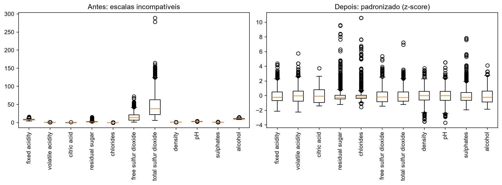
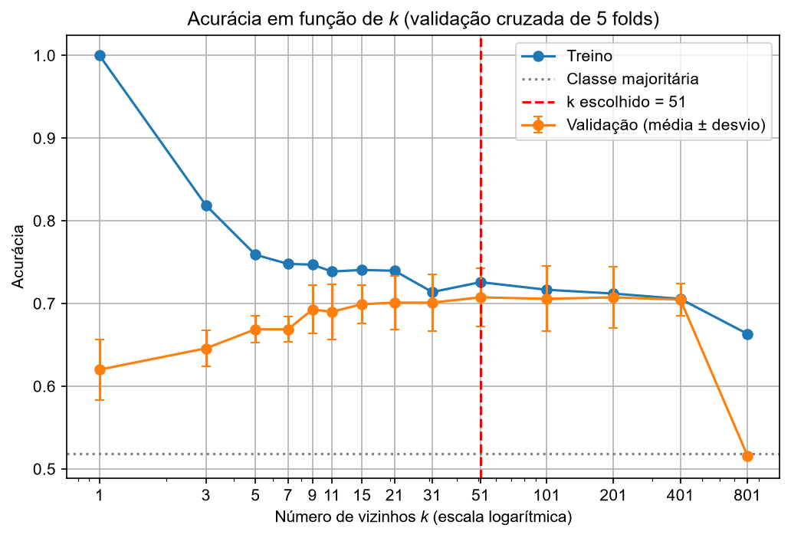
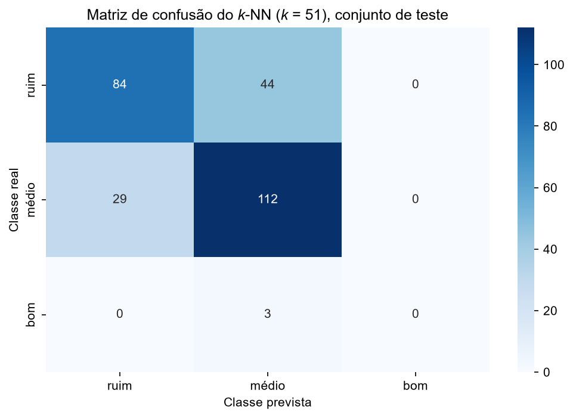

# Problema 3: Classificação de Qualidade de Vinhos Utilizando k-NN

**Disciplina:** PAM0466 Sistemas Inteligentes | UFERSA, Centro Multidisciplinar Pau dos Ferros | 2026.2
**Aluno:** João Lucas Oliveira de Andrade
**Código:** [notebook.ipynb](notebook.ipynb)

---

## 1. Introdução

A avaliação da qualidade de vinhos depende historicamente de avaliações humanas, que são caras, lentas e subjetivas. Um modelo preditivo de qualidade tem aplicações no controle de lotes, na precificação e na certificação de denominação de origem, e ajuda a identificar quais variáveis químicas mais influenciam a percepção de qualidade.

Neste trabalho foi construído um classificador **k-NN (k-Nearest Neighbors)** que atribui cada vinho a uma de **três categorias de qualidade** (ruim, médio e bom) a partir de seus atributos físico-químicos. O código segue o notebook de k-NN da disciplina (`07_kNN.ipynb`): `train_test_split` estratificado, `KNeighborsClassifier`, `confusion_matrix` e `accuracy_score`; a escolha de $k$ usa `cross_val_score` com 5 *folds*, como no notebook de regressão logística (`06_Regressao_Logistica.ipynb`).

### Dataset

**Wine Quality, arquivo `winequality-red.csv`** (Cortez et al., 2009; UCI): 1.599 amostras de vinho tinto *Vinho Verde*, com **11 atributos físico-químicos** (acidez fixa, acidez volátil, ácido cítrico, açúcar residual, cloretos, dióxido de enxofre livre e total, densidade, pH, sulfatos e teor alcoólico) e uma nota de qualidade de 0 a 10 atribuída por *sommeliers*.

### O algoritmo k-NN

O k-NN é um algoritmo **baseado em instâncias**: o "treinamento" apenas armazena o conjunto de treino. Para classificar uma nova amostra $\mathbf{x}^*$, calcula-se a distância até todas as amostras de treino, selecionam-se as $k$ mais próximas e a classe é decidida por **votação majoritária** entre esses vizinhos. A proximidade é medida pela distância euclidiana, o que torna o método sensível à escala dos atributos.

---

## 2. Tarefa 1: Preparação dos dados

### 2.1 Dados incompletos e redundantes

- **Valores ausentes:** nenhum.
- **Linhas duplicadas:** **240** (15% do arquivo). Seguindo a aula de pré-processamento (dados redundantes), as duplicatas foram **removidas**, restando **1.359 amostras**.

A remoção é especialmente importante para o k-NN: se uma cópia de uma amostra cai no treino e outra no teste (ou em *folds* diferentes da validação cruzada), o vizinho mais próximo da amostra avaliada é a sua própria cópia, com o mesmo rótulo, e o modelo "acerta" sem ter aprendido nada. Isso infla a acurácia, principalmente para $k = 1$. De fato, numa versão anterior deste trabalho, **sem** remover as duplicatas, a validação cruzada escolhia $k = 1$ (acurácia de validação de 0,7248); **com** a remoção, $k = 1$ passou a ter a **pior** acurácia de validação (0,6201).

### 2.2 Recodificação da qualidade

Distribuição das notas (após remover duplicatas):

| Nota | 3 | 4 | 5 | 6 | 7 | 8 |
|---|---|---|---|---|---|---|
| Amostras | 10 | 53 | 577 | 535 | 167 | 17 |

A variável `quality` foi recodificada em três classes:

| Classe | Regra | Amostras | Proporção |
|---|---|---|---|
| ruim | nota ≤ 5 | 640 | 47,09% |
| médio | nota 6 ou 7 | 702 | 51,66% |
| bom | nota ≥ 8 | 17 | 1,25% |

O conjunto é **fortemente desbalanceado**: a classe "bom" tem apenas 17 amostras.

### 2.3 Normalização

Os atributos têm escalas muito diferentes:

| Atributo | Mínimo | Máximo | Desvio padrão |
|---|---|---|---|
| total sulfur dioxide | 6 | 289 | 33,41 |
| free sulfur dioxide | 1 | 72 | 10,45 |
| chlorides | 0,012 | 0,611 | 0,049 |
| density | 0,9901 | 1,0037 | 0,0019 |

Os atributos foram normalizados por **Z-score**, $z = (x-\mu)/\sigma$, com `StandardScaler` ajustado **apenas no treino** e aplicado ao teste, evitando *data leakage*.

**Por que a normalização é obrigatória para o k-NN.** "Próximo" é definido pela distância euclidiana:

$$d(\mathbf{p},\mathbf{q}) = \sqrt{\sum_{j=1}^{11}(p_j-q_j)^2}$$

Sem normalização, os atributos de maior escala numérica dominam a soma: uma diferença de dezenas em dióxido de enxofre total contribui com um termo milhões de vezes maior que uma diferença de milésimos em densidade, e os atributos de escala pequena praticamente deixam de influenciar quem são os vizinhos. A geometria do problema passa a depender da **unidade de medida**, e não da relevância química. A padronização deixa todos os atributos com média 0 e desvio 1, de modo que cada um contribua de forma comparável para a distância.

**Verificação experimental.** Com validação cruzada de 5 *folds* no treino e $k = 11$, a acurácia média foi de **0,6210 sem normalização** e **0,6900 com normalização**, um ganho de cerca de 7 pontos percentuais.

---

## 3. Tarefa 2: Divisão treino/teste estratificada

Os dados foram divididos em **80% para treino (1.087 amostras)** e **20% para teste (272 amostras)**, com `random_state=42` e **divisão estratificada** (`stratify=y`), que mantém a proporção das três classes nos dois conjuntos.

| Conjunto | ruim | médio | bom | Total |
|---|---|---|---|---|
| Treino | 512 | 561 | 14 | 1.087 |
| Teste | 128 | 141 | 3 | 272 |

Sem estratificação, um sorteio simples poderia deixar o teste sem nenhum vinho "bom". Mesmo com ela, restaram **apenas 3 amostras "bom" no teste e 14 no treino**.

**Referência:** um classificador que sempre prevê a classe majoritária ("médio", `DummyClassifier`) acerta **51,84%** do teste.

---

## 4. Tarefa 3: Treinamento e escolha do k

Para cada $k$, o modelo foi avaliado por **validação cruzada de 5 *folds* sobre o treino** (`cross_val_score(..., cv=5)`). Além dos valores sugeridos no enunciado, foram testados valores grandes, até 801 (cada partição de treino da validação tem cerca de 870 amostras), para observar o que acontece com $k$ muito alto. Também foi registrada a acurácia no próprio treino.

| k | Acurácia de treino | Acurácia de validação (média) | Desvio entre *folds* |
|---|---|---|---|
| 1 | 1,0000 | 0,6201 | 0,0369 |
| 3 | 0,8188 | 0,6458 | 0,0217 |
| 5 | 0,7590 | 0,6688 | 0,0160 |
| 7 | 0,7479 | 0,6688 | 0,0151 |
| 9 | 0,7470 | 0,6928 | 0,0293 |
| 11 | 0,7387 | 0,6900 | 0,0334 |
| 15 | 0,7406 | 0,6992 | 0,0228 |
| 21 | 0,7397 | 0,7011 | 0,0326 |
| 31 | 0,7139 | 0,7011 | 0,0340 |
| **51** | 0,7259 | **0,7075** | 0,0354 |
| 101 | 0,7167 | 0,7057 | 0,0394 |
| 201 | 0,7121 | 0,7075 | 0,0372 |
| 401 | 0,7056 | 0,7047 | 0,0198 |
| 801 | 0,6633 | 0,5161 | 0,0025 |

**Resposta: valor de k escolhido.** Pelo critério de maior acurácia média de validação, o valor escolhido foi **k = 51** (0,7075). O mesmo valor foi atingido em $k = 201$; em caso de empate, ficou o menor $k$ (o primeiro máximo). A escolha é pouco decisiva: entre $k = 15$ e $k = 401$ a curva forma um **platô**, com acurácias entre 0,699 e 0,708, diferenças menores que o desvio entre os *folds* (de 0,02 a 0,04).

### O que acontece com k muito baixo e muito alto?

Os resultados reproduzem o dilema viés-variância visto em aula:

- **k muito baixo (k = 1): sobreajuste (*overfitting*), alta variância.** Cada vinho é classificado pelo seu único vizinho mais próximo, e o modelo acompanha qualquer ruído do treino. A acurácia de treino é **1,0000** (o vizinho mais próximo de um ponto de treino é ele mesmo), contra **0,6201** na validação: uma diferença de cerca de 38 pontos percentuais. É o diagnóstico "treino muito bom e validação ruim → decora".
- **k intermediário (15 a 401):** a diferença entre treino e validação cai para poucos pontos percentuais e a validação atinge o platô de cerca de 0,70: o modelo fica mais suave e generaliza melhor.
- **k muito alto (k = 801): subajuste (*underfitting*), alto viés.** A vizinhança passa a cobrir quase todo o conjunto de treino, e a votação é decidida pela classe mais frequente. A acurácia de validação cai para **0,5161**, praticamente igual à do classificador que sempre prevê "médio" (0,5184), e a de treino também cai (0,6633). É o diagnóstico "treino e validação ruins → não aprende".

---

## 5. Tarefa 4: Avaliação no conjunto de teste

O modelo final ($k = 51$, padronização ajustada no treino) foi treinado com todo o treino e avaliado no teste: **acurácia de 0,7206** (196 acertos em 272), cerca de 20 pontos percentuais acima de sempre prever "médio" (0,5184).

### 5.1 Matriz de confusão

| Real \ Previsto | ruim | médio | bom |
|---|---|---|---|
| **ruim** | 84 | 44 | 0 |
| **médio** | 29 | 112 | 0 |
| **bom** | 0 | 3 | 0 |

### 5.2 Métricas por classe

| Classe | Precisão | Recall | F1-score | Suporte |
|---|---|---|---|---|
| ruim | 0,74 | 0,66 | 0,70 | 128 |
| médio | 0,70 | 0,79 | 0,75 | 141 |
| bom | 0,00 | 0,00 | 0,00 | 3 |
| **Acurácia** | | | **0,72** | 272 |
| Média macro | 0,48 | 0,48 | 0,48 | 272 |
| Média ponderada | 0,71 | 0,72 | 0,72 | 272 |

### 5.3 Entre quais classes o modelo erra com mais frequência?

**Resposta:** entre **ruim e médio**. Dos **76 erros** do teste, **73 (96%)** são confusões entre essas duas classes: **44 vinhos "ruim" previstos como "médio"** (o erro mais frequente, 58% de todos os erros) e 29 vinhos "médio" previstos como "ruim". Os outros 3 erros são os vinhos "bom" previstos como "médio".

Uma explicação plausível é que ruim e médio são classes **vizinhas na escala de qualidade**, separadas pela fronteira entre as notas 5 e 6, e vinhos próximos a essa fronteira têm perfis químicos parecidos, o que dificulta a separação por distância. As notas 5 e 6 são, além disso, as mais frequentes (577 e 535 amostras). O erro em "ruim → médio" ser maior que o oposto é coerente com "médio" ser a classe majoritária, que tende a ganhar as votações com $k$ grande.

### 5.4 A classe "bom"

O modelo **não acertou nenhum** dos 3 vinhos "bom" do teste (recall e precisão iguais a zero). Com $k = 51$ e apenas 14 vinhos "bom" no treino, mesmo que todos os vinhos bons do treino estivessem entre os vizinhos, eles nunca formariam maioria na votação: o k-NN, como configurado, **não consegue prever essa classe**.

A acurácia global (0,72) esconde esse problema, porque a classe "bom" representa só 1% do teste. Como visto na aula de métricas, a **média macro** revela o fracasso: F1 macro de **0,48**, contra 0,72 na média ponderada. Possíveis melhorias, vistas em aula mas **não testadas** aqui, seriam o balanceamento do treino (por exemplo, SMOTE, aplicado só no treino) e o uso de um $k$ menor dentro do platô.

---

## 6. Limitações

- **Classe minoritária ("bom"):** com 17 amostras no total, as estimativas para essa classe têm pouca confiabilidade, e o modelo escolhido não a prevê.
- **Escolha de k pouco decisiva:** os valores de $k$ entre 15 e 401 estão dentro do desvio entre *folds*.
- **Uma única divisão treino/teste** (`random_state=42`) e teste pequeno: o erro-padrão aproximado da acurácia é de cerca de 2,7 pontos percentuais ($\sqrt{p(1-p)/n}$ com $p = 0{,}72$ e $n = 272$).
- **Rótulos subjetivos:** a qualidade vem de avaliação sensorial humana, o que limita a precisão alcançável a partir da química.

---

## 7. Conclusão

1. **Preparação:** o arquivo tem 1.599 amostras, sem valores ausentes, mas com 240 duplicatas, que foram removidas (1.359 amostras). A recodificação resultou em 640 vinhos "ruim", 702 "médio" e 17 "bom" (1,25%). A normalização por Z-score é obrigatória para o k-NN (distância euclidiana) e elevou a acurácia de validação de 0,6210 para 0,6900 ($k = 11$).
2. **Divisão:** estratificada, com 1.087 amostras no treino e 272 no teste.
3. **Escolha de k:** pela validação cruzada de 5 *folds*, $k = 51$ (0,7075), dentro de um platô entre $k = 15$ e $k = 401$. Com $k = 1$ houve sobreajuste (treino 1,0000 × validação 0,6201) e com $k = 801$, subajuste (validação 0,5161, igual a prever sempre a classe majoritária).
4. **Avaliação:** acurácia de 0,7206 no teste. O modelo erra principalmente entre **ruim e médio** (73 dos 76 erros) e não identifica nenhum vinho "bom", o que só aparece nas métricas por classe e na média macro (F1 de 0,48).

---

## 8. Reprodutibilidade

- Código: [notebook.ipynb](notebook.ipynb), executável no Google Colab ou localmente (`pip install -r requirements.txt` na raiz do repositório).
- Dataset: UCI Machine Learning Repository, *Wine Quality* (`winequality-red.csv`), carregado por URL.
- Semente aleatória: `random_state=42` (divisão treino/teste).

---

## 9. Referências

1. SOUZA, P. T. V. *Sistemas Inteligentes*: slides 04 (Pré-processamento), 05 (Métricas de Performance) e 08 (k-NN) e notebooks `04_Preprocessamento.ipynb`, `06_Regressao_Logistica.ipynb` e `07_kNN.ipynb`. UFERSA, 2026. Disponível em: https://github.com/pedrothiag/intelligent-systems.
2. CORTEZ, P.; CERDEIRA, A.; ALMEIDA, F.; MATOS, T.; REIS, J. Modeling wine preferences by data mining from physicochemical properties. *Decision Support Systems*, v. 47, n. 4, p. 547-553, 2009.
