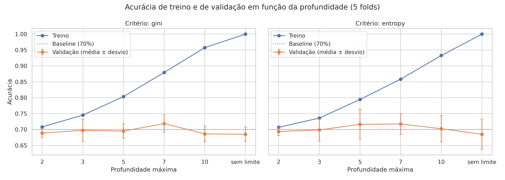
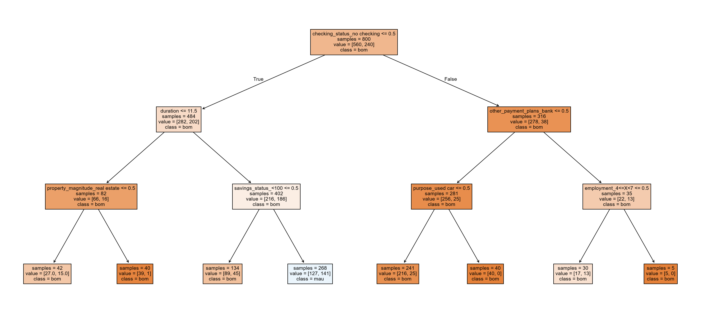
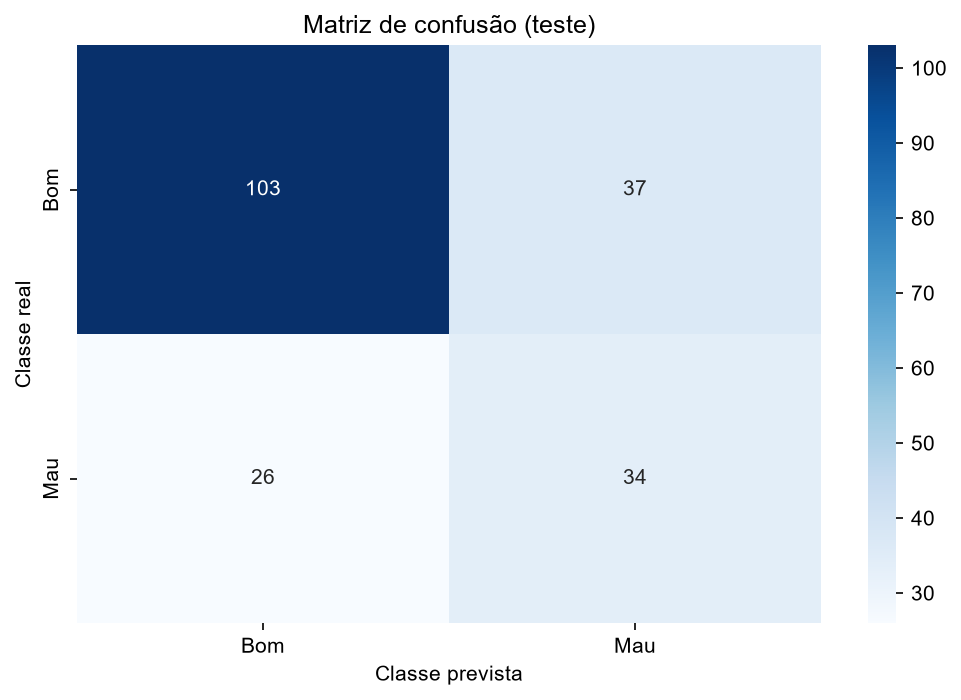

# Problema 4: Classificação de Risco de Crédito Utilizando Árvores de Decisão

**Disciplina:** PAM0466 Sistemas Inteligentes | UFERSA, Centro Multidisciplinar Pau dos Ferros | 2026.2
**Aluno:** João Lucas Oliveira de Andrade
**Código:** [notebook.ipynb](notebook.ipynb)

---

## 1. Introdução

A concessão de crédito é uma das decisões mais sensíveis do sistema financeiro: aprovar um cliente inadimplente gera prejuízo direto, mas recusar um bom pagador significa perda de receita e exclusão financeira. Aqui não basta acertar, é preciso **justificar a decisão**: a LGPD (Lei 13.709/2018), em seu Art. 20, assegura ao titular o direito de solicitar a revisão de decisões tomadas exclusivamente com base em tratamento automatizado, o que valoriza modelos interpretáveis.

A árvore de decisão atende a esse requisito: o modelo aprendido pode ser lido como um conjunto de **regras de produção** que um analista, um cliente ou um auditor compreendem sem conhecimento estatístico. Neste trabalho, construiu-se uma árvore de decisão para classificar solicitantes de crédito em **bom pagador** e **mau pagador**.

### Dataset

**Statlog (German Credit Data)** (UCI; doado por Hans Hofmann, Universidade de Hamburgo, em 1994): **1.000 solicitações de crédito** reais de um banco alemão, descritas por **20 atributos (7 numéricos e 13 categóricos)**. O rótulo indica se o cliente representou um bom risco (700 amostras) ou um mau risco (300 amostras). Foi usada a versão com rótulos legíveis, obtida por `fetch_openml(name='credit-g', version=1)`.

### Fundamentação teórica

A árvore de decisão particiona recursivamente o espaço de atributos por meio de testes condicionais sucessivos. Cada nó interno aplica um teste do tipo $x_j \le \theta$: as amostras que respondem **sim** seguem para o ramo da esquerda e as que respondem **não**, para o da direita. A construção segue estes passos:

1. **Busca da melhor divisão:** para cada atributo, os limiares candidatos são os **pontos médios entre valores consecutivos** observados; para cada candidato, calcula-se o **ganho de impureza**, isto é, a impureza do nó pai menos a impureza **ponderada** dos dois filhos, e escolhe-se a divisão de maior ganho (busca gulosa).
2. **Critérios de parada:** o nó vira folha quando todas as amostras são da mesma classe, quando há menos amostras que o mínimo exigido para dividir, quando a profundidade máxima é atingida ou quando nenhuma divisão produz ganho.
3. **Predição da folha:** a folha devolve a **classe majoritária** das amostras de treino que a alcançaram.

Para um nó $D$, sendo $p_i$ a proporção de amostras da classe $i$, as duas medidas de impureza são:

$$\text{Gini}(D) = 1 - \sum_{i=1}^{k} p_i^2 \qquad\qquad \text{Entropia}(D) = -\sum_{i=1}^{k} p_i \log_2 p_i$$

Ambas valem zero em um nó puro e são máximas quando as classes estão igualmente misturadas. A profundidade máxima (`max_depth`) controla a complexidade: árvores muito rasas tendem ao **subajuste (underfitting)** e árvores muito profundas, ao **sobreajuste (overfitting)**.

**Implementação.** O fluxo do código segue o notebook de árvores de decisão da disciplina (`08_Tree.ipynb`): divisão estratificada com `random_state=42`, `DecisionTreeClassifier` com `criterion`, `max_depth`, `min_samples_split=2` e `min_samples_leaf=1`, visualização com `plot_tree` (com `class_names`), estrutura textual com `export_text`, e avaliação com `accuracy_score` e `confusion_matrix`. Ele foi adaptado ao problema com: *one-hot encoding* dos atributos categóricos, baseline para as classes desbalanceadas, escolha da profundidade por validação cruzada, importância dos atributos, regra da folha e métricas por classe.

---

## 2. Tarefa 1: Preparação dos dados

### 2.1 Atributos numéricos e categóricos

O dataset foi carregado com dimensão **(1000, 20)** e **nenhum valor ausente**.

- **Numéricos (7):** `duration`, `credit_amount`, `installment_commitment`, `residence_since`, `age`, `existing_credits`, `num_dependents`.
- **Categóricos (13):** `checking_status`, `credit_history`, `purpose`, `savings_status`, `employment`, `personal_status`, `other_parties`, `property_magnitude`, `other_payment_plans`, `housing`, `job`, `own_telephone`, `foreign_worker`.

| Atributo categórico | Nº de categorias |
|---|---|
| purpose | 10 |
| savings_status, credit_history, employment | 5 cada |
| checking_status, personal_status, property_magnitude, job | 4 cada |
| other_parties, other_payment_plans, housing | 3 cada |
| own_telephone, foreign_worker | 2 cada |

Estatísticas dos atributos numéricos:

| Atributo | Média | Desvio padrão | Mínimo | Máximo |
|---|---|---|---|---|
| duration (meses) | 20,90 | 12,06 | 4 | 72 |
| credit_amount | 3271,26 | 2822,74 | 250 | 18424 |
| installment_commitment | 2,973 | 1,119 | 1 | 4 |
| residence_since | 2,845 | 1,104 | 1 | 4 |
| age (anos) | 35,55 | 11,38 | 19 | 75 |
| existing_credits | 1,407 | 0,578 | 1 | 4 |
| num_dependents | 1,155 | 0,362 | 1 | 2 |

### 2.2 Codificação das variáveis categóricas

As implementações de árvore do scikit-learn exigem entradas numéricas, portanto os atributos categóricos precisam ser codificados. Foi usado o ***one-hot encoding*** (`pd.get_dummies`), que cria uma coluna binária (0 ou 1) para cada categoria, evitando impor uma ordem numérica artificial entre categorias **nominais** (como finalidade do empréstimo ou tipo de moradia). A codificação ordinal só seria adequada para atributos com ordem natural entre as categorias. Todas as categorias foram mantidas (sem descartar uma delas), para que qualquer categoria possa aparecer nas regras da árvore.

Após a codificação, o conjunto passou a ter **61 colunas**: 7 numéricas e 54 colunas binárias (soma das categorias dos 13 atributos). Na árvore, cada categoria vira um teste binário "pertence ou não a essa categoria", e um corte `<= 0,50` em uma coluna binária significa que o cliente **não** pertence àquela categoria.

### 2.3 Balanceamento das classes e impacto sobre a acurácia

| Classe | Amostras | Proporção |
|---|---|---|
| 0 (bom pagador) | 700 | 70,0% |
| 1 (mau pagador) | 300 | 30,0% |

O conjunto é **desbalanceado (70% / 30%)**. Consequência para a interpretação da acurácia: um classificador "ingênuo" que prevê sempre "bom pagador" alcança **70% de acurácia sem ter aprendido nada**. Isso foi verificado no conjunto de teste com um `DummyClassifier(strategy='most_frequent')`:

| Classe | Precisão | Recall | F1 | Suporte |
|---|---|---|---|---|
| Bom (0) | 0,70 | 1,00 | 0,82 | 140 |
| Mau (1) | 0,00 | 0,00 | 0,00 | 60 |
| **Acurácia** | | | **0,70** | 200 |

O baseline tem acurácia de 0,70, mas **recall zero** para o mau pagador: não identifica nenhum cliente inadimplente. Portanto, a acurácia isolada **não é uma boa medida** neste problema: o desempenho do modelo deve ser lido em relação ao baseline de 70% e acompanhado de **matriz de confusão, precisão, recall e F1 da classe minoritária** (mau pagador), que é a de maior interesse para o banco.

---

## 3. Tarefa 2: Por que a normalização não é necessária para árvores de decisão

Diferentemente de algoritmos baseados em **distância** (como k-NN e k-Means) ou em **otimização por gradiente** (como regressão logística e redes neurais), a árvore de decisão **não depende da escala dos atributos**.

- **Razão:** cada divisão compara **um único atributo** com um limiar, $x_j \le \theta$, e o limiar é escolhido para maximizar o ganho de impureza, o que depende apenas da **ordem relativa** dos valores daquele atributo, nunca da sua magnitude nem de comparações entre atributos diferentes.
- **Invariância a transformações monotônicas:** se aplicarmos a um atributo qualquer função estritamente crescente $g$ (como a normalização Min-Max ou o Z-score), a ordem entre as amostras é preservada, $x_a \le x_b \iff g(x_a) \le g(x_b)$. O limiar ótimo passa a ser $g(\theta)$ e a partição das amostras nos nós filhos permanece **exatamente a mesma**; logo, a árvore aprendida é equivalente.
- **Em contraste,** no k-NN a distância euclidiana soma contribuições de todos os atributos, de modo que os de maior escala (aqui, `credit_amount`, com desvio de 2.823, contra `num_dependents`, com desvio de 0,36) dominariam.

**Verificação experimental.** Treinou-se a árvore final (Gini, profundidade 7) duas vezes: com os atributos numéricos originais e com eles padronizados (Z-score). A acurácia no teste foi de **0,6650 nos dois casos** e as **previsões foram idênticas**, o que confirma a invariância. Por isso, nenhuma normalização foi aplicada ao modelo final.

---

## 4. Tarefa 3: Divisão treino/teste estratificada

Os dados foram divididos em **80% para treino (800 amostras)** e **20% para teste (200 amostras)**, com `random_state=42` e **divisão estratificada** (`stratify=y`), que mantém a proporção das duas classes nos dois conjuntos: **30% de maus pagadores tanto no treino (240 de 800) quanto no teste (60 de 200)**. A estratificação garante que o teste seja representativo da população original, o que é especialmente importante com classes desbalanceadas.

---

## 5. Tarefa 4: Controle de complexidade (profundidade máxima)

Para cada profundidade máxima (2, 3, 5, 7, 10 e sem limite), a árvore foi avaliada por **validação cruzada estratificada de 5 *folds* no conjunto de treino**, registrando a acurácia média de treino e de validação, com o critério **Gini** e depois com **Entropia**.

| Critério | Profundidade | Acurácia de treino | Acurácia de validação | Desvio |
|---|---|---|---|---|
| Gini | 2 | 0,7081 | 0,6888 | 0,0139 |
| Gini | 3 | 0,7453 | 0,6975 | 0,0353 |
| Gini | 5 | 0,8034 | 0,6950 | 0,0228 |
| Gini | **7** | 0,8794 | **0,7188** | 0,0274 |
| Gini | 10 | 0,9575 | 0,6862 | 0,0248 |
| Gini | sem limite | 1,0000 | 0,6850 | 0,0226 |
| Entropia | 2 | 0,7069 | 0,6938 | 0,0125 |
| Entropia | 3 | 0,7359 | 0,6988 | 0,0352 |
| Entropia | 5 | 0,7944 | 0,7162 | 0,0469 |
| Entropia | **7** | 0,8584 | **0,7175** | 0,0329 |
| Entropia | 10 | 0,9328 | 0,7025 | 0,0416 |
| Entropia | sem limite | 1,0000 | 0,6850 | 0,0467 |



**Resposta: profundidade escolhida.** Com o critério Gini, a profundidade com maior acurácia média de validação foi **7** (0,7188 ± 0,0274). **Essa escolha é pouco decisiva:** as acurácias de validação ficam todas entre 0,685 e 0,719, a diferença entre a melhor e as demais é de poucos pontos percentuais, e o desvio entre os *folds* é de 0,014 a 0,047, ou seja, do mesmo tamanho ou maior que essas diferenças. Além disso, a melhor validação (0,7188) está apenas cerca de **2 pontos percentuais acima do baseline de 70%**, e as profundidades 2, 3, 5, 10 e "sem limite" do critério Gini ficaram **abaixo** do baseline.

### O que acontece com profundidades muito baixas e muito altas?

- **Profundidade muito baixa (2):** a árvore tem poucas regras e não captura a complexidade do problema: acurácia de treino de 0,7081 e de validação de 0,6888, ambas próximas do baseline de 0,70 e próximas entre si. Isso é compatível com **subajuste (underfitting)**, com alto viés.
- **Profundidade muito alta (sem limite):** a árvore cresce até que as folhas fiquem puras e atinge acurácia de treino de **1,0000**, mas a validação é de **0,6850**: a árvore "decora" ruídos e particularidades do treino. A diferença de **cerca de 31,5 pontos percentuais** entre treino e validação caracteriza **sobreajuste (overfitting)**, com alta variância.
- **Faixa intermediária:** a validação foi máxima na profundidade 7 e caiu nas maiores (0,6862 em 10 e 0,6850 sem limite), enquanto a acurácia de treino subiu continuamente (de 0,7081 para 1,0000). A diferença treino − validação cresce de cerca de 0,02 (profundidade 2) para cerca de 0,16 (profundidade 7) e 0,31 (sem limite).

### Gini versus Entropia

Com o critério de entropia, a melhor profundidade também foi **7**, com acurácia de validação de **0,7175** (± 0,0329), contra **0,7188** (± 0,0274) do Gini: uma diferença de 0,0013, **muito menor que o desvio entre os *folds***. Em algumas profundidades a diferença foi maior (por exemplo, na profundidade 5: 0,7162 para entropia contra 0,6950 para Gini), mas também dentro do desvio entre os *folds* (0,023 a 0,047). **Conclusão:** não houve diferença relevante entre os dois critérios neste conjunto, o que é coerente com o fato de ambos medirem a impureza de forma semelhante.

---

## 6. Tarefa 5: Interpretação do modelo

Foi treinada a árvore com critério Gini e profundidade máxima 7, resultando em uma árvore de **profundidade 7 com 59 folhas**.



A figura mostra os primeiros 4 níveis (a árvore completa é grande demais para ser legível). A raiz divide pelo atributo `checking_status_no checking`.

**Estrutura textual (`export_text`), primeiros níveis.** Como na saída do notebook da disciplina, cada linha é um teste e as linhas com `<=` são o ramo "sim" (esquerda) e as com `>` são o ramo "não" (direita):

```
|--- checking_status_no checking <= 0.50
|   |--- duration <= 11.50
|   |   |--- ...
|   |--- duration >  11.50
|   |   |--- savings_status_<100 <= 0.50
|   |   |   |--- ...
|   |   |--- savings_status_<100 >  0.50
|   |   |   |--- ...
|--- checking_status_no checking >  0.50
|   |--- other_payment_plans_bank <= 0.50
|   |   |--- ...
|   |--- other_payment_plans_bank >  0.50
|   |   |--- ...
```

Em colunas *one-hot*, `<= 0.50` significa que o cliente **não pertence** à categoria e `> 0.50` que **pertence**. Assim, a raiz separa os clientes **sem conta corrente** (ramo `> 0.50`) dos que possuem conta corrente (ramo `<= 0.50`). A árvore completa tem 59 folhas e está no notebook.

### 6.1 Importância dos atributos

A importância de cada atributo é a redução total de impureza que ele proporciona em todas as divisões em que aparece (normalizada para somar 1). Dos 61 atributos, **32 têm importância maior que zero**.

| Posição | Atributo | Importância |
|---|---|---|
| 1 | `checking_status_no checking` | 0,1886 |
| 2 | `duration` | 0,1345 |
| 3 | `credit_amount` | 0,1244 |
| 4 | `purpose_education` | 0,0485 |
| 5 | `age` | 0,0416 |

**Resposta:** os três atributos mais determinantes para a classificação foram **`checking_status_no checking`**, **`duration`** e **`credit_amount`**, que juntos respondem por cerca de **45%** da importância total (0,1886 + 0,1345 + 0,1244). Em termos de negócio, as três coisas que mais separam os clientes na árvore são a situação da conta corrente (aqui, a categoria "sem conta corrente"), o prazo do empréstimo e o valor solicitado, o que é plausível do ponto de vista de risco de crédito. Duas ressalvas: a importância **não informa o sentido** do efeito (se a categoria aumenta ou reduz o risco), apenas o quanto o atributo foi usado para reduzir impureza; e, como os atributos categóricos foram transformados em colunas binárias, a importância de um atributo categórico fica **dividida** entre suas colunas (por exemplo, `savings_status` e `employment` aparecem em várias colunas com importâncias menores).

### 6.2 Regra da folha com mais maus pagadores

A folha com o **maior número de amostras de mau pagador** (no treino) concentra **44 maus e 53 bons** (45,4% de maus). O caminho da raiz até ela é:

```
checking_status_no checking <= 0.50
duration > 11.50
savings_status_<100 > 0.50
duration > 15.50
duration <= 47.50
credit_amount > 2321.00
credit_amount <= 8015.50
```

**Em linguagem natural** (simplificando as condições redundantes sobre `duration`):

> **SE** o cliente **possui conta corrente** (não está na categoria "sem conta corrente")
> **E** tem **poupança inferior a 100** (`savings_status_<100`)
> **E** o **prazo** do empréstimo está **entre 15,5 e 47,5 meses**
> **E** o **valor do crédito** está **entre 2.321 e 8.015,5**
> **ENTÃO** o cliente cai em uma folha com 44 maus e 53 bons pagadores (45,4% de maus), que a árvore classifica como **bom pagador**, por ser a classe majoritária da folha.

Esse resultado merece atenção: a folha com **mais maus pagadores em número absoluto** não é uma folha de "mau risco", pois a classe majoritária nela ainda é "bom" (53 contra 44). Isso ilustra que "maior número de amostras de mau pagador" não equivale a "alta proporção de maus pagadores", e que a folha é grande (97 amostras do treino) e relativamente impura. Para uma regra que defenda a recusa de crédito, é preciso olhar folhas em que a árvore prediz "mau". Na própria estrutura textual há um exemplo vizinho a essa folha: com o mesmo caminho até `duration > 15.50` e `duration <= 47.50`, mas com `credit_amount <= 2321.00`, as duas folhas resultantes predizem **mau pagador**. Em linguagem natural:

> **SE** o cliente **possui conta corrente**
> **E** tem **poupança inferior a 100**
> **E** o **prazo** está **entre 15,5 e 47,5 meses**
> **E** o **valor do crédito é de até 2.321**
> **ENTÃO** a árvore o classifica como **mau pagador**.

Esse trecho mostra, ainda, um padrão que não deve ser lido como causal: dentro do mesmo ramo, créditos de até 2.321 levam a "mau" e créditos entre 2.321 e 8.015,5 levam a "bom". Trata-se do que a árvore aprendeu nos dados de treino, e um padrão desse tipo pode refletir particularidades da amostra (a árvore tem 59 folhas e muitas folhas pequenas), e não uma regra geral de risco.

---

## 7. Tarefa 6: Avaliação no conjunto de teste

O modelo (Gini, profundidade 7) foi avaliado nas **200 amostras de teste** (nunca vistas no treino), obtendo **acurácia de 0,6650** (133 acertos em 200), **abaixo do baseline de 0,70**. O erro-padrão aproximado da acurácia é de cerca de 3,3 pontos percentuais ($\sqrt{p(1-p)/n}$ com $p=0{,}665$ e $n=200$).

### 7.1 Matriz de confusão



| Real \ Previsto | Bom pagador (0) | Mau pagador (1) |
|---|---|---|
| **Bom pagador (0)** | 109 (VN) | 31 (FP) |
| **Mau pagador (1)** | 36 (FN) | 24 (VP) |

### 7.2 Métricas por classe

| Classe | Precisão | Recall | F1-score | Suporte |
|---|---|---|---|---|
| Bom pagador (0) | 0,75 | 0,78 | 0,76 | 140 |
| Mau pagador (1) | 0,44 | 0,40 | 0,42 | 60 |
| **Acurácia** | | | **0,67** | 200 |
| Média macro | 0,59 | 0,59 | 0,59 | 200 |
| Média ponderada | 0,66 | 0,67 | 0,66 | 200 |

$$\text{Precisão}=\frac{VP}{VP+FP},\qquad \text{Recall}=\frac{VP}{VP+FN},\qquad F1=2\cdot\frac{\text{Precisão}\cdot\text{Recall}}{\text{Precisão}+\text{Recall}}$$

**Leitura em relação ao baseline.** A acurácia do modelo (0,665) é **menor** que a do classificador ingênuo (0,70), mas os dois não são comparáveis apenas por esse número: o baseline não identifica nenhum mau pagador (recall 0,00), enquanto o modelo identifica 24 dos 60 (**recall de 0,40**), ao custo de recusar 31 bons pagadores. Ou seja, o modelo troca acurácia global por capacidade de detectar inadimplentes, mas essa capacidade é **modesta**: ele deixa passar 60% dos maus pagadores do teste.

### 7.3 Qual tipo de erro é mais frequente e por que é o mais grave?

**Resposta:** o erro mais frequente foi o **falso negativo**, isto é, prever "bom pagador" para um cliente que é **mau pagador**: **36 casos**, contra 31 falsos positivos (a diferença é pequena). Dos 67 erros totais, 36 (cerca de 54%) são falsos negativos.

Esse é também o erro **mais grave** na aplicação: significa **conceder crédito a quem não vai pagar**, com perda do capital emprestado, enquanto o erro oposto (recusar um bom pagador) implica perda de receita futura (juros não recebidos) e exclusão financeira do cliente. A documentação original do dataset (arquivo `german.doc`) traz uma matriz de custos que penaliza mais o primeiro erro **[PREENCHER: conferir o valor da matriz de custos no `german.doc` antes de citá-lo, ou apagar esta frase]**. No teste, o modelo deixou de identificar **36 dos 60 maus pagadores (60%)**.

### 7.4 Ajuste no treinamento para reduzir o erro mais grave

Para reduzir os falsos negativos da classe "mau pagador", propõe-se:

1. **Ponderação de classes** (`class_weight='balanced'`): penaliza mais os erros na classe minoritária durante o cálculo da impureza.
2. **Matriz de custos assimétrica** (por exemplo, errar um mau pagador custar várias vezes mais que recusar um bom pagador).
3. **Ajuste do limiar de decisão**, reduzindo o limiar de probabilidade para classificar como mau pagador abaixo de 0,50 (não testado neste trabalho).

**Demonstração da ponderação de classes.** Treinando a mesma árvore (Gini, profundidade 7) com `class_weight='balanced'`, o resultado no teste foi:

| Modelo | Acurácia | Recall (mau) | Precisão (mau) | Falsos negativos | Falsos positivos |
|---|---|---|---|---|---|
| Sem ponderação | 0,6650 | 0,40 | 0,44 | 36 | 31 |
| `class_weight='balanced'` | 0,5850 | 0,57 | 0,37 | 26 | 57 |

A ponderação **reduziu os falsos negativos de 36 para 26** (recall do mau pagador de 0,40 para 0,57), mas **aumentou os falsos positivos de 31 para 57** e reduziu a acurácia global em cerca de 8 pontos percentuais: mais maus pagadores são identificados, ao custo de recusar mais bons pagadores. A escolha entre os dois comportamentos depende do custo relativo de cada erro para o banco. Essa demonstração serve para ilustrar o efeito e **não foi usada para escolher hiperparâmetros** (o que seria olhar o conjunto de teste).

---

## 8. Limitações

- **Desempenho modesto:** a acurácia no teste (0,665) ficou abaixo do baseline (0,70), e o recall do mau pagador é de apenas 0,40. A árvore, nesta configuração, identifica uma minoria dos inadimplentes.
- **Escolha de profundidade pouco decisiva:** as diferenças entre as profundidades e entre os critérios estão dentro do desvio entre os *folds*, e a melhor validação supera o baseline por cerca de 2 pontos percentuais.
- **Conjunto de teste pequeno:** 200 amostras (60 maus pagadores); as métricas, em especial as da classe minoritária, têm incerteza considerável, e apenas uma divisão treino/teste (`random_state=42`) foi avaliada.
- **Interpretabilidade limitada:** a árvore escolhida tem 59 folhas, o que torna a leitura das regras trabalhosa; há tensão entre desempenho e legibilidade (uma árvore mais rasa teria regras mais simples; por exemplo, a de profundidade 3 teve validação de 0,6975, dentro do desvio entre os *folds* da profundidade 7).
- **Instabilidade das árvores:** pequenas variações nos dados podem alterar a estrutura da árvore, e as importâncias e regras descrevem este ajuste, não verdades gerais.
- **Importâncias com atributos one-hot:** a importância de um atributo categórico fica dividida entre suas colunas binárias.
- **Dataset pequeno e de origem única** (um banco alemão, década de 1990): os resultados podem não se generalizar, por exemplo, para o crédito no Brasil.
- **Atributos sensíveis:** o dataset contém atributos como estado civil/sexo (`personal_status`) e idade; seu uso em decisões reais de crédito exige avaliação jurídica e de equidade, fora do escopo deste trabalho.

---

## 9. Conclusão

1. **Preparação:** o dataset tem 1.000 solicitações (7 atributos numéricos e 13 categóricos), sem valores ausentes, codificadas com *one-hot* em 61 colunas. As classes estão desbalanceadas (70% / 30%), e o baseline que sempre prevê "bom pagador" atinge 70% de acurácia com recall zero para o mau pagador. A normalização não é necessária para árvores (invariância a transformações monotônicas), o que foi confirmado experimentalmente (previsões idênticas com e sem padronização).
2. **Complexidade:** a profundidade escolhida por validação cruzada foi 7 (validação de 0,7188, treino de 0,8794), com escolha pouco decisiva. Profundidades baixas (2) levaram a acurácias próximas do baseline (subajuste) e profundidades altas, a sobreajuste (treino de 1,0000 contra validação de 0,6850 sem limite). Entre Gini e Entropia não houve diferença relevante (0,7188 contra 0,7175).
3. **Interpretação:** os atributos mais determinantes foram `checking_status_no checking`, `duration` e `credit_amount` (cerca de 45% da importância). A folha com mais maus pagadores (44 maus e 53 bons) é, na verdade, classificada como "bom", o que mostra que o maior número absoluto de maus pagadores não corresponde a uma folha de alto risco.
4. **Avaliação:** acurácia de 0,6650 no teste, abaixo do baseline, com recall de 0,40 para o mau pagador. O erro mais grave, o falso negativo, ocorreu 36 vezes (60% dos maus pagadores do teste). A ponderação de classes reduziu os falsos negativos para 26, ao custo de mais falsos positivos (57) e menor acurácia.

---

## 10. Reprodutibilidade

- Código: [notebook.ipynb](notebook.ipynb), executável no Google Colab.
- Dataset: UCI Machine Learning Repository, *Statlog (German Credit Data)*, obtido por `fetch_openml(name='credit-g', version=1)`.
- Bibliotecas: `pandas`, `numpy`, `matplotlib`, `seaborn`, `scikit-learn`.
- Semente aleatória: `random_state=42` (divisão treino/teste, validação cruzada e árvores).

---

## 11. Referências

1. FACELI, K.; LORENA, A. C.; GAMA, J.; ALMEIDA, T. A.; CARVALHO, A. C. P. L. F. *Inteligência Artificial: Uma Abordagem de Aprendizado de Máquina*. LTC. **[PREENCHER: conferir edição e ano na bibliografia indicada pelo professor.]**
2. COPPIN, B. *Artificial Intelligence Illuminated*. Jones & Bartlett. **[PREENCHER: conferir edição e ano na bibliografia indicada pelo professor.]**
3. HOFMANN, H. *Statlog (German Credit Data)*. UCI Machine Learning Repository, 1994.
4. Notebook de árvores de decisão da disciplina (`08_Tree.ipynb`, repositório `intelligent-systems`, Prof. Pedro Thiago Valério de Souza).

