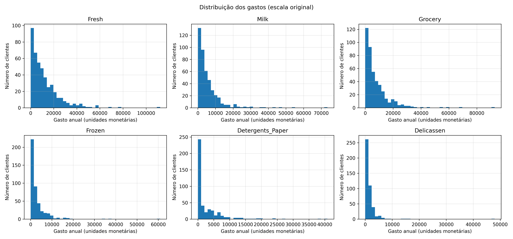
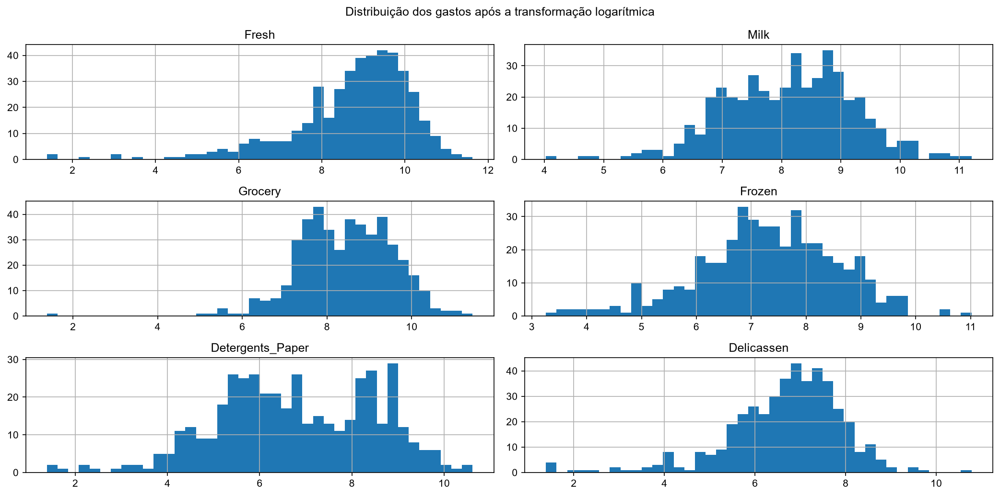
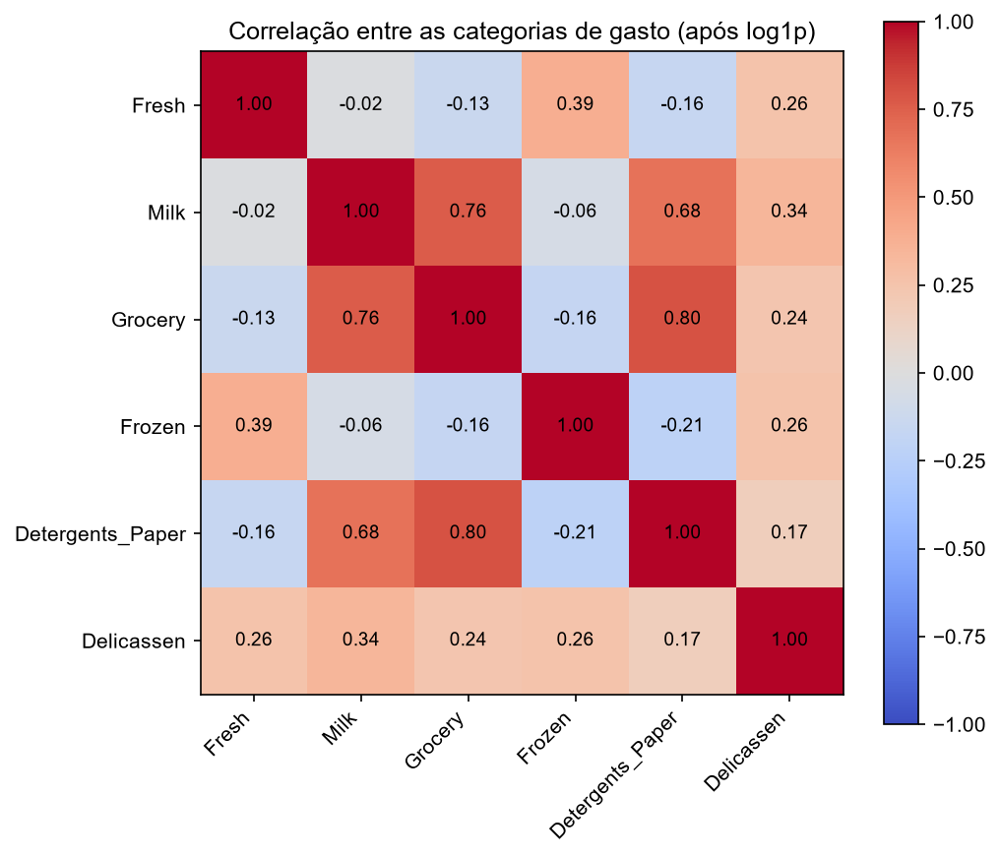
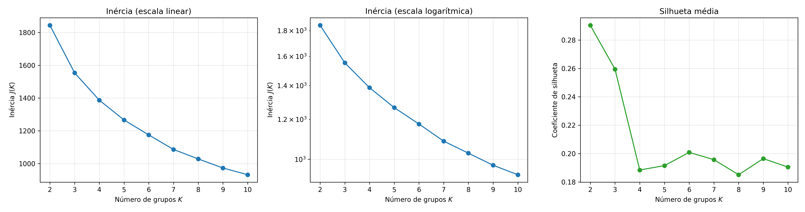
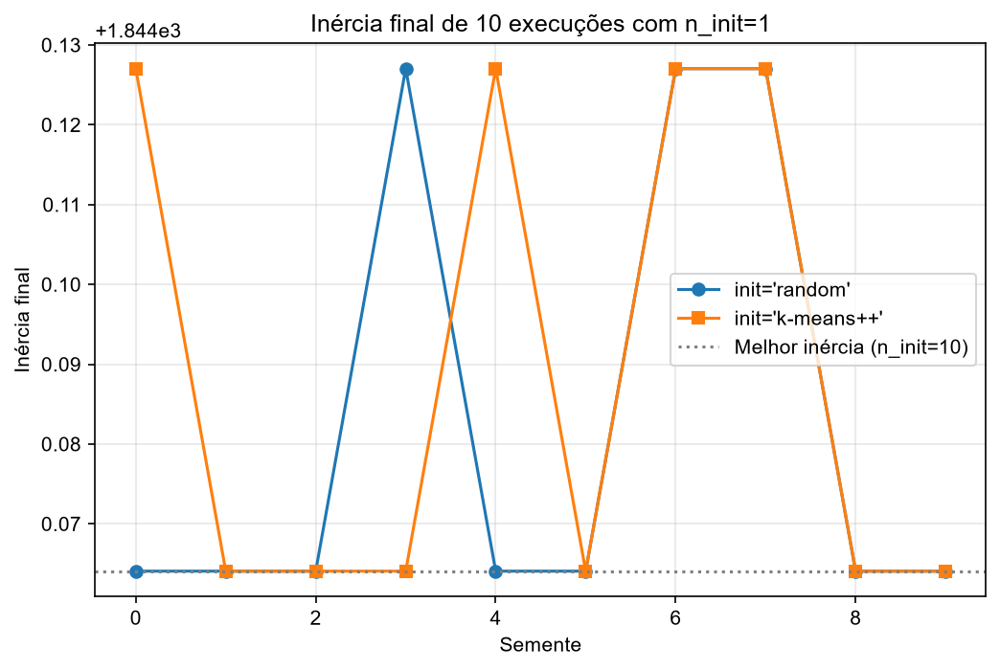
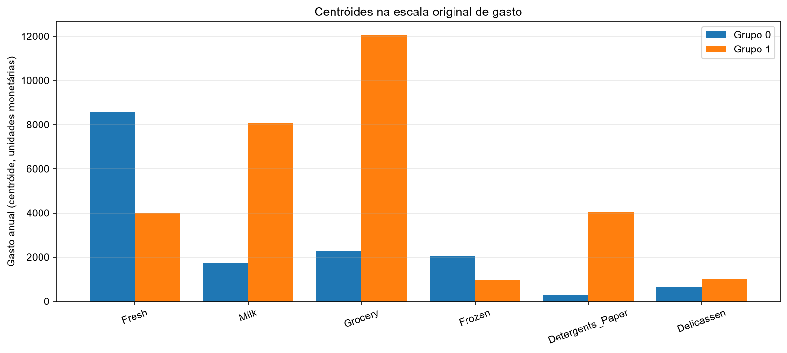
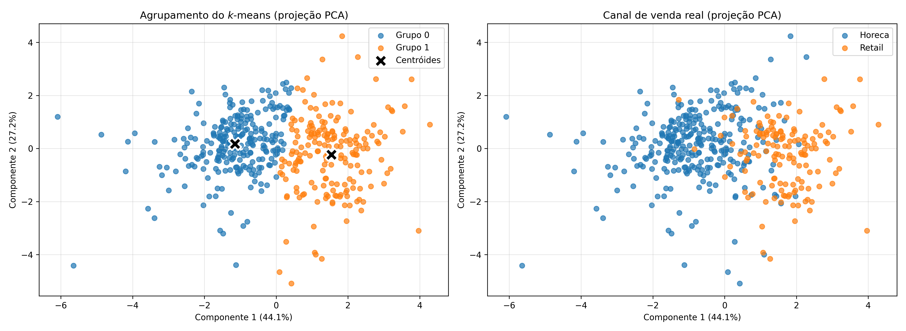

# Problema 5: Segmentação de Clientes Utilizando k-Means

**Disciplina:** PAM0466 Sistemas Inteligentes | UFERSA, Centro Multidisciplinar Pau dos Ferros | 2026.2
**Aluno:** João Lucas Oliveira de Andrade
**Código:** [notebook.ipynb](notebook.ipynb)

---

## 1. Introdução

Um distribuidor atacadista atende, ao mesmo tempo, clientes muito diferentes entre si, como o restaurante que compra hortifrúti e congelados em alto giro e o pequeno mercado de bairro que se abastece de mercearia, laticínios e produtos de limpeza. Tratá-los com a mesma política comercial desperdiça margem e capacidade logística. A segmentação de clientes tem aplicações no planejamento de rotas e estoques, em campanhas promocionais dirigidas, na concessão de limites de crédito e na identificação de clientes atípicos.

Este projeto é de **aprendizado não supervisionado**: ninguém classificou previamente os clientes em "perfil restaurante" ou "perfil varejo"; se esses grupos existem, eles precisam emergir da estrutura dos gastos. Foi usado o algoritmo de agrupamento **k-means**.

### Dataset

**Wholesale Customers** (UCI; doado por Margarida G. M. S. Cardoso, ISCTE-IUL, Lisboa, em 2014): **440 clientes** de um distribuidor atacadista português. Para cada cliente, os gastos anuais, em unidades monetárias, em seis categorias de produto, e dois atributos categóricos.

| Atributo | Descrição | Uso |
|---|---|---|
| Fresh | Gasto anual em frescos | agrupamento |
| Milk | Gasto anual em laticínios | agrupamento |
| Grocery | Gasto anual em mercearia | agrupamento |
| Frozen | Gasto anual em congelados | agrupamento |
| Detergents_Paper | Gasto anual em detergentes e papel | agrupamento |
| Delicassen | Gasto anual em delicatessen | agrupamento |
| Channel | Canal: 1 = Horeca (hotéis, restaurantes e cafés), 2 = Retail (varejo) | **apenas validação externa** |
| Region | Região: 1 = Lisboa, 2 = Porto, 3 = outras | **apenas validação externa** |

`Channel` e `Region` **não foram usados no agrupamento**: ficaram reservados para a validação externa da Tarefa 5.

### Fundamentação teórica (notebook da disciplina)

O k-means busca a partição $\{C_1,\dots,C_K\}$ e os centróides $\mathbf{m}_1,\dots,\mathbf{m}_K$ que minimizam a **inércia**:

$$J = \sum_{k=1}^{K}\sum_{\mathbf{x}_i \in C_k}\|\mathbf{x}_i - \mathbf{m}_k\|^2$$

O algoritmo de Lloyd alterna dois passos até a convergência: **atribuição** (cada objeto vai para o grupo do centróide mais próximo) e **atualização** (cada centróide passa a ser a média dos objetos do seu grupo). Nenhum dos passos aumenta $J$, então o algoritmo sempre converge, mas para um **mínimo local** que depende da inicialização.

Decomposição da variabilidade: $\text{SST} = \text{SSW} + \text{SSB}$, em que SSW (soma de quadrados intragrupos) é a própria inércia e mede a **coesão**, e SSB mede a **separação** entre grupos. Como SST depende só dos dados, minimizar SSW equivale a maximizar SSB.

**Coeficiente de silhueta** de um objeto $i$ do grupo $C_I$, com $a(i)$ a distância média aos demais objetos do seu grupo e $b(i)$ a menor distância média a objetos de outro grupo:

$$s(i) = \frac{b(i) - a(i)}{\max\{a(i),\,b(i)\}}$$

A silhueta média resume a partição. Interpretação usual (Kaufman e Rousseeuw, 1990): 0,71 a 1,00 estrutura forte; 0,51 a 0,70 estrutura razoável; 0,26 a 0,50 estrutura fraca, possivelmente artificial; abaixo de 0,25, nenhuma estrutura substancial.

---

## 2. Tarefa 1: Preparação dos dados

### 2.1 Carregamento e separação das variáveis

O arquivo foi carregado com dimensão **(440, 8)** e **nenhum valor ausente**. O canal tem **298 clientes Horeca e 142 Retail**, e a região tem 77 clientes em Lisboa, 47 no Porto e 316 em outras regiões. `Channel` e `Region` foram separados da matriz de atributos; o agrupamento usou apenas as seis categorias de gasto.

### 2.2 Estatísticas descritivas e assimetria

| Categoria | Média | Mediana | Desvio padrão | Mínimo | Máximo | Assimetria |
|---|---|---|---|---|---|---|
| Fresh | 12000,30 | 8504,0 | 12647,33 | 3 | 112151 | 2,56 |
| Milk | 5796,27 | 3627,0 | 7380,38 | 55 | 73498 | 4,05 |
| Grocery | 7951,28 | 4755,5 | 9503,16 | 3 | 92780 | 3,59 |
| Frozen | 3071,93 | 1526,0 | 4854,67 | 25 | 60869 | 5,91 |
| Detergents_Paper | 2881,49 | 816,5 | 4767,85 | 3 | 40827 | 3,63 |
| Delicassen | 1524,87 | 965,5 | 2820,11 | 3 | 47943 | 11,15 |

As distribuições são **fortemente assimétricas à direita**: em todas as categorias a média é bem maior que a mediana (por exemplo, Detergents_Paper tem média de 2881 e mediana de 816) e a assimetria é positiva e alta (de 2,56 a 11,15). Há poucos clientes com gasto muito elevado: em Fresh, os valores vão de 3 a 112.151 unidades monetárias, e o desvio padrão (12.647) é maior que a própria média (12.000).

### 2.3 Transformação logarítmica e padronização

Foi aplicada a transformação $x' = \log(1+x)$ e, em seguida, a padronização por $Z$-score. Cada etapa tem uma justificativa própria.

**(a) Por que a transformação logarítmica é recomendável.** As distribuições dos gastos são assimétricas à direita e têm *outliers* (poucos clientes com gasto muito superior ao restante). Como o k-means usa médias (os centróides) e distâncias ao quadrado, esses poucos clientes de gasto muito elevado exercem uma influência desproporcional: eles puxam os centróides e podem fazer o algoritmo dedicar grupos a clientes extremos em vez de capturar a estrutura da maioria. O logaritmo **comprime a cauda**: transforma diferenças multiplicativas em aditivas, de modo que a diferença entre gastar 100 e 1.000 passa a ter peso semelhante à diferença entre gastar 1.000 e 10.000. Usa-se $\log(1+x)$, e não $\log(x)$, porque o gasto pode ser zero ($\log 0$ não é definido).

Efeito sobre a assimetria:

| Categoria | Assimetria original | Assimetria após log1p |
|---|---|---|
| Fresh | 2,561 | −1,575 |
| Milk | 4,054 | −0,224 |
| Grocery | 3,587 | −0,675 |
| Frozen | 5,908 | −0,353 |
| Detergents_Paper | 3,632 | −0,236 |
| Delicassen | 11,152 | −1,092 |

O valor absoluto da assimetria diminuiu em todas as categorias. Em `Fresh` e `Delicassen`, porém, ainda há assimetria considerável após o log (−1,58 e −1,09), agora com cauda à **esquerda**; é plausível que isso se deva aos valores muito baixos dessas categorias (há mínimos de 3 unidades), que o logaritmo afasta do centro da distribuição (hipótese, não verificada).

**(b) Por que a padronização é determinante para o k-means.** O k-means atribui cada objeto ao centróide mais próximo segundo a **distância euclidiana**:

$$d(\mathbf{x},\mathbf{m}_k)=\sqrt{\sum_{j=1}^{6}(x_j-m_{kj})^2}$$

Se os atributos estiverem em escalas ou variabilidades diferentes, aqueles de maior amplitude numérica dominam a soma e decidem sozinhos a que centróide cada cliente pertence, enquanto os demais praticamente não influenciam a atribuição. A padronização coloca todos os atributos com média 0 e desvio padrão 1, de modo que cada categoria contribua de forma comparável para a distância. Isso vale mesmo depois do log, porque as categorias continuam com médias e dispersões diferentes entre si. Foi verificado no notebook que, após a padronização, a média de cada atributo é 0 e o desvio padrão é 1.

### 2.4 Correlação entre as categorias

Correlação de Pearson após o log (a matriz na escala original está no notebook):

| | Fresh | Milk | Grocery | Frozen | Detergents_Paper | Delicassen |
|---|---|---|---|---|---|---|
| **Fresh** | 1,000 | −0,021 | −0,133 | 0,386 | −0,159 | 0,256 |
| **Milk** | −0,021 | 1,000 | 0,761 | −0,055 | 0,679 | 0,342 |
| **Grocery** | −0,133 | 0,761 | 1,000 | −0,165 | 0,797 | 0,240 |
| **Frozen** | 0,386 | −0,055 | −0,165 | 1,000 | −0,213 | 0,256 |
| **Detergents_Paper** | −0,159 | 0,679 | 0,797 | −0,213 | 1,000 | 0,168 |
| **Delicassen** | 0,256 | 0,342 | 0,240 | 0,256 | 0,168 | 1,000 |

**Par `Grocery`–`Detergents_Paper`:** a correlação foi de **0,925** na escala original e de **0,797** após o logaritmo, a mais alta entre todos os pares em ambas as escalas. Isso significa que os clientes que gastam muito em mercearia tendem a gastar muito em detergentes e papel, o que é plausível para estabelecimentos de varejo, que revendem produtos secos e de limpeza (hipótese de negócio, não verificada). Além disso, `Milk` também é bastante correlacionada com as duas (0,761 com Grocery e 0,679 com Detergents_Paper, após o log), formando um **bloco de três categorias** que carregam informação parecida. Consequência para o k-means: como cada categoria entra com o mesmo peso na distância, esse bloco responde por boa parte da variação que o algoritmo "enxerga", e é de se esperar que a separação dos grupos seja guiada principalmente por ele. `Fresh` e `Frozen` têm correlação de 0,386 entre si e são pouco ou negativamente correlacionadas com o bloco.

---

## 3. Tarefa 2: Ausência de divisão treino/teste

Diferentemente dos projetos anteriores (regressão, classificação), aqui **não se separa um conjunto de teste**.

- **Aprendizado supervisionado:** existe um rótulo conhecido, e o objetivo é aprender uma função que o preveja em dados novos. O conjunto de teste serve para **estimar o erro de generalização** comparando previsões com rótulos conhecidos.
- **Aprendizado não supervisionado:** não há rótulo a prever. O objetivo é **descrever a estrutura dos próprios dados** (os grupos), e não generalizar uma função de entrada para saída; portanto não há erro de generalização sobre rótulos a ser estimado. Separar um teste também reduziria o número de clientes disponíveis para revelar a estrutura de grupos.

**Dificuldade central da validação em agrupamento:** sem um gabarito, **como afirmar que uma partição é "boa"?** Diferentes valores de $K$ sempre produzem partições, e a inércia sempre diminui com $K$, de modo que o algoritmo não diz, por si só, qual partição é a correta. Os critérios de validação se dividem em: **internos** (usam só os dados e a partição, combinando coesão e separação, como a silhueta), **externos** (comparam a partição a rótulos de referência, como o índice de Rand ajustado, raramente disponíveis) e **relativos** (comparam partições com parâmetros diferentes, como diferentes $K$). Mesmo assim, "bom" depende também da **utilidade para o negócio**: um segmento só é útil se a área comercial souber o que fazer com ele.

---

## 4. Tarefa 3: Escolha do número de grupos

O k-means foi executado para $K$ de 2 a 10 (com `n_init=10` e `random_state=42`), registrando a inércia e a silhueta média. A redução relativa da inércia ao passar de $K-1$ para $K$ é $\Delta_\%(K) = 100\,\frac{J(K-1)-J(K)}{J(K-1)}$.

| K | Inércia J(K) | Redução (%) | Silhueta média |
|---|---|---|---|
| **2** | 1844,1 | | **0,2903** |
| 3 | 1553,4 | 15,8 | 0,2594 |
| 4 | 1386,9 | 10,7 | 0,1885 |
| 5 | 1266,1 | 8,7 | 0,1916 |
| 6 | 1174,8 | 7,2 | 0,2009 |
| 7 | 1086,4 | 7,5 | 0,1958 |
| 8 | 1028,5 | 5,3 | 0,1852 |
| 9 | 973,1 | 5,4 | 0,1965 |
| 10 | 932,0 | 4,2 | 0,1905 |

**Resposta: K escolhido.** Foi escolhido **K = 2**. Justificativa à luz dos dois critérios e da interpretabilidade:

- **Silhueta:** a maior silhueta média ocorre em K = 2 (**0,2903**), seguida de K = 3 (0,2594); a partir de K = 4 ela fica estável, entre 0,185 e 0,201. Pela tabela de Kaufman e Rousseeuw, mesmo o melhor valor (0,29) indica **estrutura fraca, possivelmente artificial**: os grupos existem, mas se sobrepõem bastante.
- **Cotovelo:** **não há um cotovelo nítido**. A maior queda da inércia está na passagem de K = 2 para K = 3 (15,8%), e depois as reduções diminuem de forma gradual (10,7%, 8,7%, 7,2%, 7,5%, 5,3%, 5,4%, 4,2%) sem um ponto de inflexão claro. Esse critério, sozinho, não decide o valor de K; a silhueta é o critério que aponta para K = 2.
- **Interpretabilidade comercial:** com K = 2, os grupos têm perfis facilmente descritíveis (Tarefa 5): um grupo orientado a frescos e congelados e outro a mercearia, laticínios e produtos de limpeza, o que dá à área comercial duas políticas distintas para trabalhar. A interpretação de K = 3 não foi examinada neste trabalho.

K foi escolhido **apenas por critérios internos (silhueta, cotovelo e interpretação dos centróides)**; as variáveis `Channel` e `Region` só foram consultadas depois, na validação externa.

### Por que a inércia decresce com K e não pode ser usada isoladamente?

A inércia ótima $J^*(K)$ **nunca aumenta** com $K$: dado o melhor agrupamento com $K$ grupos, é sempre possível obter $K+1$ grupos com inércia menor ou igual, por exemplo dividindo um grupo em dois (cada novo grupo tem soma de quadrados menor ou igual à do grupo original). Isso se vê na tabela, em que a inércia cai de 1844,1 (K = 2) para 932,0 (K = 10). Por isso, **minimizar a inércia levaria sempre ao maior K possível**, sem informar a estrutura real dos dados. Ela serve para comparar execuções com o **mesmo** $K$, mas não para escolher $K$.

**Caso limite $K = n$:** com um centróide por cliente, cada objeto é o seu próprio centróide e a inércia vale **zero**. Isso foi verificado: com K = 440, a inércia obtida foi **0,000000**. A partição seria perfeita pelo critério da inércia e completamente inútil do ponto de vista de segmentação, o que mostra por que ela não pode ser usada isoladamente.

---

## 5. Tarefa 4: Inicialização e convergência

O k-means converge para um **mínimo local**. Para observar o efeito da inicialização, o algoritmo foi executado **dez vezes** com `init='random'` e `n_init=1`, usando sementes de 0 a 9, e depois dez vezes com `init='k-means++'`, com K = 2.

| Semente | Inércia (random) | Inércia (k-means++) |
|---|---|---|
| 0 | 1844,0641 | 1844,1270 |
| 1 | 1844,0641 | 1844,0641 |
| 2 | 1844,0641 | 1844,0641 |
| 3 | 1844,1270 | 1844,0641 |
| 4 | 1844,0641 | 1844,1270 |
| 5 | 1844,0641 | 1844,0641 |
| 6 | 1844,1270 | 1844,1270 |
| 7 | 1844,1270 | 1844,1270 |
| 8 | 1844,0641 | 1844,0641 |
| 9 | 1844,0641 | 1844,0641 |

| Estatística | random | k-means++ |
|---|---|---|
| Mínimo | 1844,0641 | 1844,0641 |
| Máximo | 1844,1270 | 1844,1270 |
| Média | 1844,0830 | 1844,0893 |
| Desvio padrão | 0,0289 | 0,0308 |
| Amplitude (máx − mín) | 0,0630 | 0,0630 |
| Execuções que atingiram a melhor inércia conhecida (`n_init=10`: 1844,0641) | 7 de 10 | 6 de 10 |

**Comparação da dispersão.** Neste conjunto, **os dois métodos tiveram desempenho praticamente idêntico**: em ambos, todas as execuções terminaram em um de apenas dois valores de inércia (1844,0641 ou 1844,1270), com amplitude de 0,063, o que equivale a cerca de 0,003% da inércia. O `random` atingiu a melhor inércia em 7 execuções e o k-means++ em 6, e o desvio padrão foi de 0,0289 e 0,0308, respectivamente. Essas diferenças são desprezíveis, e com apenas 10 execuções por método **não é possível afirmar que um seja melhor que o outro**. A existência de dois valores de inércia sugere duas soluções locais muito próximas (a diferença de 0,063 pode corresponder à troca de grupo de poucos clientes; isso não foi verificado). Ou seja, com K = 2 e 440 clientes, o problema é "fácil" para o algoritmo, e a vantagem do k-means++ não aparece.

**Que problema o k-means++ busca mitigar e como.** A inicialização aleatória escolhe $K$ objetos quaisquer como centróides iniciais; se dois deles caírem na mesma região densa, o algoritmo pode ficar preso em um **mínimo local ruim**, com inércia alta. O k-means++ sorteia o primeiro centróide uniformemente e escolhe cada novo centróide com probabilidade proporcional a $D(\mathbf{x})^2$, o quadrado da distância de $\mathbf{x}$ ao centróide já escolhido mais próximo:

$$P(\mathbf{x}) = \frac{D(\mathbf{x})^2}{\sum_{\mathbf{x}'} D(\mathbf{x}')^2}$$

Assim, objetos distantes dos centróides já escolhidos têm mais chance de ser sorteados, e os centróides iniciais tendem a ficar **espalhados pelo espaço**, o que reduz a chance de um mínimo local ruim, mas **não a elimina**. O efeito é mais visível quando há mais grupos ou configurações iniciais ruins (como no experimento do notebook da disciplina, com quatro grupos); com K = 2 e dados deste tamanho, ele não aparece. Por isso recomenda-se também executar o algoritmo várias vezes (`n_init`) e manter a solução de menor inércia, que foi o que se fez no modelo final. A `scikit-learn` usa uma variante "gulosa" do k-means++, que testa vários candidatos a cada novo centróide.

---

## 6. Tarefa 5: Interpretação e validação dos grupos

Com K = 2, o modelo final (`n_init=10`, `random_state=42`) obteve inércia de **1844,0641**, convergiu em **13 iterações** (melhor execução) e teve silhueta média de **0,2903**, com **252 clientes no Grupo 0 (57,3%)** e **188 no Grupo 1 (42,7%)**.

### 6.1 Centróides na escala original

Os centróides foram revertidos desfazendo a padronização (`inverse_transform`) e depois a transformação logarítmica ($e^{x'}-1$):

| Grupo | Fresh | Milk | Grocery | Frozen | Detergents_Paper | Delicassen | Nº de clientes |
|---|---|---|---|---|---|---|---|
| Grupo 0 | **8580,6** | 1753,7 | 2274,4 | **2063,8** | 287,4 | 649,4 | 252 |
| Grupo 1 | 4013,9 | **8061,6** | **12051,1** | 953,5 | **4035,6** | **1022,1** | 188 |

**Nota de interpretação:** como o centróide foi calculado no espaço logarítmico, o valor revertido corresponde à **exponencial da média dos logaritmos** dos gastos do grupo (algo próximo de uma média geométrica), e **não** à média aritmética dos gastos, que costuma ser maior em distribuições assimétricas à direita. Por isso os valores devem ser lidos como o gasto "típico" do grupo.

**Nomes descritivos, baseados nas categorias em que cada grupo se destaca:**

- **Grupo 0: "Foodservice (perfil Horeca): frescos e congelados".** Gasta cerca de **2,1 vezes** mais que o Grupo 1 em `Fresh` (8.581 contra 4.014) e em `Frozen` (2.064 contra 954), e muito pouco em `Detergents_Paper` (287). É o perfil de estabelecimentos que preparam refeições, com alto giro de perecíveis. A área comercial poderia priorizar, para esse segmento, logística de entrega frequente e condições especiais em frescos e congelados.
- **Grupo 1: "Varejo de mercearia: secos, laticínios e limpeza".** Destaca-se em `Grocery` (12.051, cerca de **5,3 vezes** o Grupo 0), `Detergents_Paper` (4.036, cerca de **14 vezes** o Grupo 0), `Milk` (8.062, cerca de **4,6 vezes**) e também em `Delicassen`. É o perfil de pontos de venda que revendem produtos de prateleira e de limpeza. Para esse segmento, campanhas de volume em mercearia, laticínios e limpeza e condições de crédito para reposição de estoque seriam mais adequadas.

A separação dos grupos é, portanto, guiada sobretudo pelo bloco de categorias correlacionadas identificado na Tarefa 1 (`Grocery`, `Detergents_Paper` e `Milk`), com `Fresh` e `Frozen` no sentido oposto.

### 6.2 Validação externa

Tabelas de contingência (o agrupamento nunca viu `Channel` nem `Region`):

| Grupo \ Canal | Horeca | Retail | % Retail no grupo |
|---|---|---|---|
| Grupo 0 | 244 | 8 | 3,2% |
| Grupo 1 | 54 | 134 | 71,3% |

| Grupo \ Região | Lisboa | Porto | Outras |
|---|---|---|---|
| Grupo 0 | 48 (19,0%) | 28 (11,1%) | 176 (69,8%) |
| Grupo 1 | 29 (15,4%) | 19 (10,1%) | 140 (74,5%) |
| *Total (440)* | *77 (17,5%)* | *47 (10,7%)* | *316 (71,8%)* |

**Índice de Rand ajustado (ARI):** com `Channel`, **0,5135**; com `Region`, **−0,0077**. O ARI vale 1 para partições idênticas e fica próximo de 0 para partições aleatórias.

**Responda: o algoritmo, sem jamais ter visto o canal de venda, foi capaz de reconstruí-lo?** **Em grande parte, mas não perfeitamente.** O Grupo 0 é composto por 96,8% de clientes Horeca (244 de 252), e o Grupo 1 por 71,3% de clientes Retail (134 de 188). Em outras palavras, o grupo 1 reúne 134 dos 142 clientes Retail (94,4%) e o grupo 0 reúne 244 dos 298 clientes Horeca (81,9%). Ao todo, 62 dos 440 clientes (14,1%) caem no grupo "contrário" ao seu canal, quase todos clientes Horeca (54) no Grupo 1. O ARI de **0,51** indica concordância **moderada**: o agrupamento captura boa parte da estrutura do canal, mas não a reproduz. Uma explicação plausível (hipótese, não verificada) é que parte dos clientes Horeca tem um perfil de compra parecido com o do varejo (clientes "mistos"). Como o canal tem dois valores e K foi escolhido como 2 por critérios internos, a comparação é direta, o que não ocorreria com outro K.

**Qual conjunto de categorias de produto mais separa Horeca de Retail?** Comparando o gasto médio padronizado de cada canal por categoria, as maiores diferenças (Retail − Horeca) foram:

| Categoria | Diferença no gasto médio padronizado |
|---|---|
| Detergents_Paper | +1,555 |
| Grocery | +1,418 |
| Milk | +1,235 |
| Frozen | −0,524 |
| Fresh | −0,363 |
| Delicassen | +0,281 |

O trio **`Detergents_Paper`, `Grocery` e `Milk`** é o que mais separa os canais, com gasto maior no Retail; `Frozen` e `Fresh` têm diferença menor e a favor do Horeca; `Delicassen` quase não separa. Isso é coerente com o perfil dos centróides: varejistas revendem produtos secos, de limpeza e laticínios, e estabelecimentos Horeca compram relativamente mais frescos e congelados para preparo.

**E a região geográfica: ela se reflete nos agrupamentos?** **Não.** As proporções de cada região são parecidas nos dois grupos (por exemplo, "Outras" representa 69,8% do Grupo 0 e 74,5% do Grupo 1, contra 71,8% no total) e o ARI com `Region` é **−0,0077**, praticamente zero. Ou seja, o perfil de consumo identificado depende do **tipo de cliente**, e não de onde ele está.

### 6.3 Projeção em duas dimensões (PCA)

Os dados padronizados foram projetados em dois componentes principais, que retêm **71,27%** da variância total (componente 1: 44,08%; componente 2: 27,19%).

O gráfico mostra uma única nuvem contínua de pontos, e não dois blocos separados: os grupos ocupam lados opostos ao longo do componente 1, com sobreposição considerável na região central. Isso é coerente com a silhueta de 0,29 (estrutura fraca).

**Duas limitações do k-means evidenciadas no gráfico:**

1. **Tendência a formar grupos de geometria esférica e de tamanhos semelhantes.** O k-means atribui cada ponto ao centróide mais próximo pela distância euclidiana, o que gera uma fronteira linear entre os grupos (diagrama de Voronoi) e favorece grupos compactos e arredondados. No gráfico, a fronteira é uma reta que **corta uma nuvem contínua** em uma região densa, sem vazio natural entre os grupos: os pontos próximos a essa reta poderiam ser classificados de forma diferente por pequenas variações, e o resultado é a sobreposição visível. Os tamanhos dos grupos também são parecidos (252 e 188), o que o algoritmo favorece.
2. **Sensibilidade a *outliers*.** Como cada centróide é a média do seu grupo, clientes com gastos extremos o deslocam e podem distorcer o grupo. A transformação logarítmica mitigou o problema, mas ainda há pontos isolados longe da nuvem (por exemplo, à esquerda, com componente 1 abaixo de −5, atribuídos ao Grupo 0, e alguns pontos acima de 4 ou abaixo de −4 no componente 2, atribuídos ao Grupo 1), que continuam influenciando a posição dos centróides.

Observação: os dois componentes retêm 71,27% da variância, portanto sobreposições no gráfico podem não existir no espaço original de seis dimensões, e vice-versa.

---

## 7. Limitações

- **Estrutura fraca:** a melhor silhueta média (0,29, em K = 2) indica estrutura fraca, e o cotovelo não é nítido; a escolha de K = 2 se apoia na silhueta e na interpretabilidade dos grupos, e **K = 3 (silhueta de 0,26) não foi examinado** em termos de interpretação.
- **Não há gabarito:** a qualidade do agrupamento depende de critérios internos e de julgamento comercial; critérios diferentes podem indicar valores diferentes de K.
- **Concordância moderada com o canal** (ARI de 0,51): 62 clientes (14,1%) ficam no grupo oposto ao do seu canal.
- **Sensibilidade à inicialização:** o k-means converge para mínimos locais; os resultados foram obtidos com `n_init=10` e `random_state=42`. No experimento com K = 2, os dois métodos de inicialização foram equivalentes, e 10 execuções não bastam para generalizar.
- **Premissa de grupos esféricos e de variâncias semelhantes** (ver Tarefa 5); estruturas de formato irregular não seriam capturadas.
- **Assimetria residual** em `Fresh` e `Delicassen` após o log, com cauda à esquerda.
- **Dataset pequeno e de origem única** (440 clientes de um distribuidor português): os perfis podem não se generalizar para o atacarejo do Nordeste brasileiro.
- **Interpretação dos centróides:** valores revertidos do espaço logarítmico representam o gasto típico, não a média aritmética.

---

## 8. Conclusão

1. **Preparação:** o dataset tem 440 clientes e seis categorias de gasto, fortemente assimétricas à direita (assimetria de 2,56 a 11,15). O log reduziu a assimetria em todas as categorias (com resíduo em `Fresh` e `Delicassen`) e a padronização igualou a contribuição de cada categoria à distância euclidiana. `Grocery` e `Detergents_Paper` têm correlação de **0,925** (original) e **0,797** (após o log), formando um bloco correlacionado com `Milk`.
2. **Escolha de K:** K = 2, com a maior silhueta média (0,2903), cotovelo pouco nítido e grupos interpretáveis; a estrutura é **fraca** (silhueta entre 0,26 e 0,50). A inércia sempre decresce com K (de 1844,1 em K = 2 a 932,0 em K = 10 e zero em K = n) e por isso não pode ser usada sozinha.
3. **Inicialização:** com K = 2, `random` e `k-means++` tiveram resultados praticamente idênticos (amplitude de 0,063 em ambos); não há evidência, neste conjunto, de vantagem de um método.
4. **Interpretação:** os grupos foram nomeados como **"Foodservice (frescos e congelados)"** (252 clientes) e **"Varejo de mercearia (secos, laticínios e limpeza)"** (188 clientes). O ARI com `Channel` foi de **0,5135**, indicando que o algoritmo reconstruiu **em grande parte, mas não totalmente,** o canal de venda; as categorias que mais separam os canais são `Detergents_Paper`, `Grocery` e `Milk`. A região geográfica **não** se reflete nos grupos (ARI de −0,0077). O PCA (71,27% da variância) mostra uma nuvem contínua com sobreposição, ilustrando as limitações do k-means.

---

## 9. Reprodutibilidade

- Código: [notebook.ipynb](notebook.ipynb), executável no Google Colab.
- Dataset: UCI Machine Learning Repository, *Wholesale Customers*, carregado por URL.
- Bibliotecas: `numpy`, `pandas`, `matplotlib`, `scikit-learn`.
- Semente aleatória: `random_state=42` (modelo final e escolha de K); sementes de 0 a 9 no experimento de inicialização.

---

## 10. Referências

1. Notebook de clusterização da disciplina (`09_Clusterizacao.ipynb`, repositório `intelligent-systems`, Prof. Pedro Thiago Valério de Souza).
2. FACELI, K.; LORENA, A. C.; GAMA, J.; ALMEIDA, T. A.; CARVALHO, A. C. P. L. F. *Inteligência Artificial: Uma Abordagem de Aprendizado de Máquina*. LTC. **[PREENCHER: conferir edição e ano na bibliografia indicada pelo professor.]**
3. COPPIN, B. *Artificial Intelligence Illuminated*. Jones & Bartlett. **[PREENCHER: conferir edição e ano na bibliografia indicada pelo professor.]**
4. CARDOSO, M. G. M. S. *Wholesale Customers*. UCI Machine Learning Repository, 2014.
5. KAUFMAN, L.; ROUSSEEUW, P. J. *Finding Groups in Data: An Introduction to Cluster Analysis*. Wiley, 1990.

